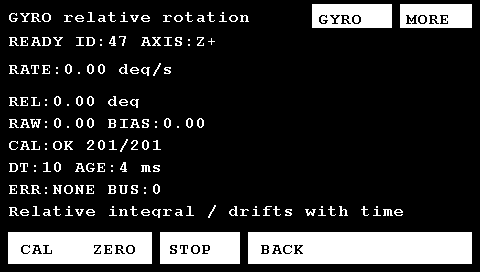

# WDS601M / ICM-42688-P：单旋转轴角速度与相对转角

日期：2026-10-21。实现于现有 `main`，起点 `50b816b`。保留原有未跟踪的 `GYRO_STAGE_TASK.md`，未新建分支/worktree、未提交或推送、未重建 CubeMX。电机/光流/扫码驱动与默认启动配置未修改。

**本阶段输出是安装映射后的角速度（°/s）和相对积分角（°），会漂移，不是绝对航向，也不是任意姿态下的欧拉 yaw。** 使用条件是所选轴基本竖直、车体近似平面运动。没有磁场或其它外部航向参考。

## 1. 资料与模式确认

先直接阅读了用户提供的两张图片：

- [模块概述、引脚和轴向](../../硬件说明/ICM-42688-P加速度六轴IMU陀螺仪/O1CN017M4IpvQErgG1bS1C_!!2214417625444.webp)。
- [引脚表续页、PS 与模式焊点说明](../../硬件说明/ICM-42688-P加速度六轴IMU陀螺仪/O1CN01o6f1eRSm9RK1bS1C_!!2214417625444.webp)。

资料显示模块带 MCU，可选择芯片直连或 MCU 解算输出。本阶段只接用户确认的芯片侧 `VCC/GND/SCL/SDA/SA0/CS/INT1/INT2`（Pin1～8）。另一侧 TX/DA、RX/CL 及板载 MCU 解算协议没有接入。图片的 500 Hz、0.01°属于模块宣传参数，不作为本工程的采样率、精度或实测结果。

**实物上电前必须核查 PS/焊点：PS 悬空，模式选择焊点不得把 PS 桥接到 H/VCC 或 L/GND。** 图片规定 PS 接 VCC 为 MCU 串口模式，接 GND 为 MCU I2C 模式。若实物仅露出 8 脚，检查右下角模式焊点/板卡版本，不虚构一个已接好的 Pin9。当前只完成资料核对，未用仪表检查用户实物的 PS/焊点，也不能由 WHO_AM_I 正确就推断板载 MCU 一定已释放总线。

随后核对 [TDK DS-000347 rev 1.6 完整手册](https://product.tdk.cn/system/files/dam/doc/product/sensor/mortion-inertial/imu/data_sheet/ds-000347-icm-42688-p-v1.6.pdf)：电气规格、接口、轴向、§12.3/12.6/12.8/12.9 及相关寄存器。芯片目标是 ICM-42688-P，读取 `0x75=0x47` 才继续；全 00/FF 或其它 ID 拒绝初始化，保留读回值供诊断。

现成驱动采用 Zephyr v3.7.0 的 C 驱动子集，保留复位/配置/DRDY 门控及 burst 解析核心逻辑；移除 RTOS/SPI/RTIO 包装，适配独立硬件 I2C。具体来源、固定提交、保留与修改的函数、选择理由和 Apache-2.0 许可见 [UPSTREAM.md](../User/gyro/UPSTREAM.md)。总线、校准、积分和应用集成为本地实现。

## 2. 接线方案

这是**与已构建固件匹配、按资料核对的接线方案**，不是已经完成的实物接线记录。断电接线，先确认核心板 J7/J45 的 1 脚方向。

| 模块芯片侧 | MCU / 电源 | 野火 V1 核心板排针 | 配置、方向与实际应接状态 |
|---|---|---|---|
| VCC，Pin1 | 3.3 V | J45-1（或 J45-3） | 给模块供电；首版用 3.3 V |
| GND，Pin2 | GND | J45-5（或 J45-6） | MCU、模块、电源共地 |
| SCL，Pin3 | PB6 / I2C1_SCL | **J7-32** | AF4、开漏、100 kHz；外部上拉到匹配的 3.3 V 逻辑电源 |
| SDA，Pin4 | PB7 / I2C1_SDA | **J7-31** | AF4、双向开漏；同上，不与触摸 SDA 连接 |
| SA0，Pin5 | 固定低 | GND，例如 J45-6 | 默认 7 位地址 **0x68**；先查已有连接再接地，不悬空 |
| CS，Pin6 | 固定高 | 3.3 V，例如 J45-3 | I2C 模式下保持高，独立于 PS；不用其它设备 CS 或 MCU 动态片选 |
| INT1，Pin7 | 首版不接 MCU | — | 芯片输出；软件设 DRDY/低有效/开漏/锁存，轮询读取，不强驱动或短接 |
| INT2，Pin8 | 首版不接 MCU | — | 保持 INT2 功能，未路由事件；不作 FSYNC/CLKIN，不强驱动或短接 |
| PS / 模式焊点 | **开路** | 不接 MCU | 按上节实物检查，芯片直连模式；没有第 9 脚时检查模式焊盘 |

排针依据：本地 `E:/MPU's_study/野火【STM32F429开发板-挑战者】资料/2-开发板硬件资料_原理图_尺寸图_封装库_规格书/ebf_stm32_tiaozhanzhe_hardware/F429_F767_挑战者_V1/原理图/F429_767_挑战者V1核心板-原理图.pdf`，第 1 页 J7/J45，第 2 页网络到 PB6/PB7。已提取文字、坐标并渲染第 1 页核对：J7-31=I2C1_4_SDA，J7-32=I2C1_4_SCL；对 F429 使用 I2C1。参考渲染留在 `Output/gyro-reference/coreboard_p1.png`。GPIO 占用核查包含当前 LCD、FMC/SDRAM、触摸、Flash、光流、扫码和 UART5，PB6/PB7 未被当前工程配置占用。

图片标称模块供电 3～5 V，**不证明芯片接口耐受 5 V**。芯片 VDD/VDDIO 范围为 1.71～3.6 V；本方案按模块接口为 3.3 V 逻辑接入。实物仍需确认模块 VDDIO、现有上拉电源及电平转换情况与方案一致。检查 SCL/SDA 是否已有上拉；没有时可用每线 4.7 kΩ 到 3.3 V 作为短线联调初值，已有上拉则核算并联总阻，再检查波形。内部弱上拉未启用，不能代替外部上拉。若板上 SA0 已固定为高，确认后改 `GYRO_ADDRESS_7BIT=0x69` 并相应接线；不自动扫描/切换到 MCU 侧地址。

I2C1 为独立、单主总线。没有改动触摸 I2C2（PH4/PH5）、光流 SPI2（PB13/PC2/PC3/PE3）、Flash SPI5、UART5、USART3/PB12、LTDC 或 FMC 的资源。恢复只复位 I2C1，不复位 I2C2、不拉触摸 RESET、不重置共享时钟。

## 3. 配置与初始化

入口为 `QrApp_Init` / `QrApp_Process`，不是孤立例程。`User/gyro/gyro_config.h` 集中配置地址、安装轴和符号：`GYRO_AXIS=0/1/2` 对应 X/Y/Z，`GYRO_SIGN=+1/-1`。默认 **Z+ 是初始配置，不是实物安装结论**；按实际竖直轴和正转方向验证后再改，重编译/复位后重新 CAL。没有运行期拼接不同方向或量程的角度。

当前固定匹配参数为陀螺低噪声、±500 °/s、100 Hz，65.5 LSB/(°/s)。加速度计、温度、APEX/DMP、FIFO 均未启用。陀螺 UI 一阶低通，BW 编码 5：手册表的 3 dB 带宽 23.8 Hz、DC 群延迟 10.2 ms；不是整条采集显示链路的实测延迟。UI 最高约 10 Hz。

初始化采用状态机，每次 `Gyro_Process` 至多一个配置事务，按下列次序完成：

1. 供电访问留出 3 ms，显式选 bank 0 并读回，核对身份。
2. 软件复位后等待至少 2 ms，检查复位位自清和 RESET_DONE，再核对身份。
3. 在 gyro/accel OFF 时，按 §12.3 设置 bank 1 INTF_CONFIG4=`0x83`、CONFIG5=`0x00`、CONFIG6=`0x5C`，回 bank 0 并读回；DRIVE_CONFIG=`0x09`，内部 PLL/RC、RTC 关闭。保留位沿用手册复位值。
4. 设置 FIFO bypass、FSYNC off、big endian/非法码模式/I2C 接口、量程/ODR/滤波，DRDY 锁存且由**传感器寄存器读取**清除，INT_ASYNC_RESET=0。每项写入后独立读回核对。
5. 最后写 PWR_MGMT0=`0x2C` 开启 gyro，等待 50 ms 才继续。此期间无寄存器写入；同时满足 OFF→ON 后 200 μs 不写寄存器与开启至少 45 ms 的不同约束。等待结束仍须新 DRDY 才发布样本。

运行期每 250 ms 做一项 ID/bank/power/FSR/interface 检查，完整一轮 1.25 秒。检测到复位、身份或配置不符即使旧数值看似正常也进入故障恢复，重初始化后必须重新 CAL。

## 4. 新鲜度、校准和积分

`GyroIo` 是注入的 init/read/write/millis/cycles 与非零 cycles_per_us；主机测试使用寄存器和假时钟替身，固件使用 HAL 与原有时基。采样轮询间隔 2 ms；一次调用至多“读状态＋六字节 gyro burst”两个事务。三个有符号 BE 轴只用于安装映射和三轴静止检查，业务输出一个轴。全零是合法静止数据；`-32768/-32767` 在所选编码下无效，接近满量程的值按饱和拒绝。

只有 DRDY 新事件进入校准和积分。同值但新 DRDY 是新样本；无 DRDY 不增加样本序号、不积分、不伪造补采。由 sense-read 清 DRDY，避免先读状态清除事件后，状态与 burst 之间更新导致下一轮重复计数。六字节连续读取，避免逐轴/逐字节拆分读取。首版没有 FIFO；错过的帧无法恢复。

时间戳使用 **MCU HAL 毫秒时钟**，取 burst 开始与结束时刻中点；不是传感器时间戳，也不是 UI 更新时间。它有毫秒量化、轮询相位、总线和中断延迟误差。无符号差值处理 32 位回绕。DWT 仅用于耗时/短 BUSY 等待，不复位 CYCCNT，不改 SysTick。

上电只到 UNCAL，**不自动校准**。等待原四轮启动测试完成且确认整车静止后，用户按 CAL，程序收集约 2 秒、至少 201 个连续新样本。各轴绝对值、窗口范围、均值及 Welford 方差检查阈值集中配置（5 °/s、1 °/s、3 °/s、0.04 (°/s)²），均是待实物验证的初值。启动测试/已知电机活动/待执行运动时拒绝或中止校准；同步功能处于禁用锁定状态本身不算运动。**电机停止、方差低都不能证明没有恒定慢转，用户仍需保证静止。**

窗口不完整、运动、漏采、总线错误、超时不更新旧零偏；保留失败原因及旧偏置作为诊断，角度连续性失效。成功才原子更新 RAM 中的偏置、角度归零并建立新的时间基准。偏置不存 Flash、不后台自适应、不用死区吞掉慢转。

采用映射后的同单位约定：`RAW = sign * raw[axis]/65.5`，`BIAS = sign * 静止均值[axis]`，`RATE = RAW - BIAS`；相邻有效样本梯形积分 `Δ角 = (前一RATE + 当前RATE)/2 × 实际dt秒`。内部 double 连续累计，可跨 ±180°/360°，不做折返；显示仅为两位小数，分辨显示不等于精度。为使用已有 ASCII 字体，界面写 `deg/s`、`deg`。

ZERO 只把最新有效样本的角度边界设为 0，保留偏置。未校准、过期或校准进行中拒绝；此时页面显示 UNCAL/CAL REQUIRED、STALE 或 KEEP STILL，应先 CAL/恢复。ZERO 不清光流累计、不改扫码会话、不发电机命令。

采样 dt 为 0 或大于 14 ms、轮询空档达到一个 ODR（10 ms）、过期（30 ms）、饱和/非法码、通信异常均中断连续性。GAP 锁存；保留旧角供快照诊断，UI 显示 `REL:-- ... GAP`，不会用旧速率补算断连期间运动。新鲜速率恢复后，需用户 ZERO 建立新角段，或 CAL。重初始化则先回 UNCAL，ZERO 不能替代重新 CAL。

总线故障按 250/500/1000/2000/4000 ms 退避尝试，正常初始化后恢复初始退避。持续 500 ms 无有效样本也重初始化。每次尝试均有限，不在全局初始化死循环中等待模块。

## 5. 最终运行效果与操作

以下行为均已由真实服务/驱动加主机替身验证，未冒充实物结果：

| 场景 | 软件当前行为 |
|---|---|
| 正常上电 | 保留原四轮一次启动/停止测试、扫码和光流；陀螺 INIT→UNCAL，原始速率可诊断，RATE/REL 为 `--` |
| 未连接、地址或模式错误 | NACK/NOT FOUND/ERROR、有限退避，原应用和 STOP 继续；不改用板载 MCU 协议 |
| GYRO 页面 | 右上 `GYRO` 进入，显示状态/ID/轴与符号、RATE、REL、RAW/BIAS、CAL 进度、dt/age/错误 |
| 静止 CAL | KEEP STILL→201 样本且满窗口→READY，角从 0 开始；长按只申请一次 |
| 正反旋转 | 数值测试中速率正负对应方向，角按实际时间累计并跨 360°；实物轴/符号仍待确认 |
| 停止旋转 | 理想主机静止样本下速率归零、角保持；实物允许漂移，30/60 秒漂移待记录 |
| ZERO | 只设新的相对角零点，保留偏置；长按一次，不动电机/扫码/光流 |
| 切 QR/MOTOR/FLOW | 陀螺后台采样继续，BACK 回到进入前的原页面；CAL/ZERO/切页不取消启动测试 |
| 漏采、断连、饱和或过期 | RATE/REL 无效时显示 `--`，ANGLE GAP 锁存，不跨缺口积分 |
| 恢复 | 普通采样缺口后新速率可恢复，但旧角仍无效；通信重新初始化后 UNCAL，需重新 CAL |
| STOP | GYRO 数据页和诊断页底部 STOP 始终复用原全体停止语义 |

按此顺序操作：

1. 断电检查模块芯片侧、PS/焊点、CS/SA0、3.3 V 与上拉，再照接线表连接。
2. 上电，按原流程运行四轮默认测试；确认测试结束/停止、整车和模块静止。
3. 右上 GYRO，确认 `ID:47`、UNCAL；核对页面安装轴配置。错误时先查模式、电源、接线、地址。
4. 保持静止，点 CAL 并松开，等待 KEEP STILL→READY；失败按 CAL 行原因处理后重新申请。
5. 手动沿实际转向轴正反旋转，确认 RATE 符号、REL 累计方向。必要时修改 AXIS/SIGN，重编、复位、重新 CAL。
6. 点 ZERO 建立本次相对起点；MORE 可看序号、最大 dt/轮询间隔、处理耗时、MISS/GAP/饱和/重初始化数，DATA 回数据页。
7. 出现 GAP 后不要把旧角用于控制。普通漏采恢复且偏置仍有效可 ZERO；重新初始化到 UNCAL 则必须静止 CAL。没有新增任何闭环转向或导航动作。

主机字体预览（模拟零速数据，不是实物截图/精度测试）：



## 6. 调度与阻塞预算

QrApp 在触摸前、光流后/显示前、显示后调用 Gyro_Process；2 ms 门控防止同一 tick 重复读样本，QR/电机调度和光流原顺序保留。画面仍局部更新，10 Hz；仅标题截短以给 GYRO/MORE 两个入口留空间。

已检查仓库 HAL 1.7.3：`HAL_I2C_Mem_Read/Write` 初始 BUSY 等待固定 25 ms，不能只靠传入 2 ms 超时。BSP 在 HAL 前检查 BUSY，留出最多 200 μs 的正常 STOP 收尾时间；持续 BUSY/低电平线拒绝进入 HAL。DWT 停止时仍有 20000 次有限循环兜底。单主独立总线下，不存在另一个软件调用方在检查后占用 I2C1。地址/收发等阻塞路径用 2 ms 事务超时（HAL 的 `> Timeout` 有毫秒边界量化），SysTick 和中断延迟仍影响墙钟上限。没有 HAL_MAX_DELAY，没有 GPIO 总线复位脉冲或无界重试。

100 kHz 的状态 1 字节加数据 6 字节，基本线上时长约 1.17 ms（不含 start/stop 和 HAL/中断额外时间）。主机四模块并行场景为最大轮询 2 ms、最大样本间隔 12 ms、漏采估计 0、Gyro_Process 最大 1170 μs；光流最大间隔 10 ms、最大处理 1028 μs。**替身的事务成本计数没有真实 LCD/I2C/UART 中断阻塞，不能推导实板必然达到这些时序。** 故障/变 dt 单元测试主动注入 100 ms 空档时观测到 104 ms 最大样本间隔，已验证不跨该段积分。

实物上必须从 MORE 读取最大间隔/处理耗时并用逻辑分析仪核对。MISS 是按可见长间隔得到的漏采下限估计，不是硬件精确丢帧计数；没有 FIFO 不能保证发现每次覆盖。若全页绘制/触摸持续令 10 ms 轮询空档或 dt>14 ms，应先记录波形，再做必要的绘制分步或 DRDY/FIFO 扩展；当前没有用重复读取补造样本掩盖问题。

## 7. 验证与资源

执行入口：

```powershell
powershell -NoProfile -ExecutionPolicy Bypass -File Scripts/test.ps1
powershell -NoProfile -ExecutionPolicy Bypass -File Scripts/build.ps1 -Rebuild
```

实施前原主机测试通过；实施后运行原有电机/七机/扫码/光流回归及新增驱动、服务、总线和 UI 测试。新增覆盖：正确/错误 ID、bank 0/1、复位时序/完成/读回、初始化失败、NACK/TIMEOUT/BUSY/一般 IO、STOP 收尾与卡线前置拒绝、0x68/0x69 地址只移位一次、BE 正负/零值/非法码/饱和、DRDY 同值与旧值、三种轴/符号构建、成功/运动/方差/均值/窗口不完整/缺样/超时/活动电机校准、失败保留旧偏置、分段正反速率/变 dt/回绕/跨360°/ZERO、不跨缺口积分及重新初始化需 CAL。

真实 QrApp/UI 测试还覆盖长按 CAL/ZERO 一次、无效值遮蔽、最大计数值字体边界、跨页后台采集、陀螺与光流分别断连恢复、扫码会话/光流累计保持、GYRO STOP，以及七电机并行。默认启动场景仍只有原 12 条四轮使能/启动/停止控制帧，1→2→3→4，未增加陀螺相关电机命令。

最终 Keil AC5 构建：**0 Error(s), 0 Warning(s)**，输出 `Output/YH-F429.axf` 与 `.hex`。默认 `MOTOR_BOOT_SEQUENCE_ENABLED=1`、`MOTOR_TEST_CONFIGURED=0`、`MOTOR_BENCH_JOG_ENABLED=1` 均保留；主机普通 UI 变体关闭启动测试，另一个专门变体用默认启动配置验收。

| 链接指标 | 基线 | 本阶段构建 | 增量 |
|---|---:|---:|---:|
| Code | 49024 B | 57708 B | 8684 B |
| RO-data | 17228 B | 17456 B | 228 B |
| RW-data | 1616 B | 1688 B | 72 B |
| ZI-data | 13600 B | 13928 B | 328 B |
| 总静态 RAM（RW+ZI） | 15216 B | 15616 B | 400 B |
| 链接 ROM | 67164 B | 76124 B | 8960 B |

`main` 静态 app 从 4768 B 增至 5008 B；私有 I2C1 句柄 84 B。维持原 4096 B 栈，未申请堆或大样本数组；校准用在线统计。静态调用图最大已知栈由 1120 增至 1248 B；QrApp_Process 帧 272 B，GyroUi_Line 已知最大深度 240 B。链接器明确标有函数指针/中断未知部分，不能把 1248 B 当作实测峰值；陀螺读/写适配已知回调深度分别 144/152 B，需后续实板栈水位验证。整数格式化配合自定义两位小数转换，不引入 `%f` 浮点 printf；相对角 double 运算开销已包含在构建中。

日志/字体预览/基线 map/调用图留在忽略的 `Output/gyro-reference/`，最终完整主机日志 `final-tests.log`，Keil 日志 `Output/build.log`，最终 map `Listings/YH-F429.map`。软件验证不代表硬件验收。

## 8. 逐文件改动理由

| 文件 | 理由 |
|---|---|
| `User/gyro/gyro_config.h` | 集中地址、轴/符号、固定采样参数和待实测校准阈值 |
| `User/gyro/icm42688.h` | 小型可注入总线与芯片状态机接口 |
| `User/gyro/icm42688.c` | 移植芯片复位/配置/DRDY burst 核心，补读回和接口配置 |
| `User/gyro/bsp_gyro_bus.h` | 向应用提供 I2C1 适配接口 |
| `User/gyro/bsp_gyro_bus.c` | PB6/PB7、独立 I2C1、有限事务/恢复、地址转换与耗时读取 |
| `User/gyro/gyro_service.h` | 单轴测量、有效性/故障/校准进度和快照 API |
| `User/gyro/gyro_service.c` | 静止统计、相对积分、ZERO、GAP 锁存及退避恢复 |
| `User/gyro/gyro_ui.h` | 简单行级显示接口 |
| `User/gyro/gyro_ui.c` | 状态/单位/诊断和无效值显示，避免浮点 printf |
| `User/gyro/UPSTREAM.md` | 固定驱动来源、保留核心与本地适配边界 |
| `User/gyro/LICENSE-Apache-2.0.txt` | 保留上游许可证 |
| `User/app/qr_app.h` | 在原应用对象增量加入陀螺服务 |
| `User/app/qr_app.c` | 初始化/后台处理、活动电机辅助门控、显式分发 CAL/ZERO，保留 boot 逻辑 |
| `User/app/qr_ui.h` | 新页面状态和独立动作枚举/快照参数 |
| `User/app/qr_ui.c` | GYRO/MORE、CAL/ZERO/BACK，继续复用按下边沿、STOP、局部刷新 |
| `Project/YH-F429.uvprojx` | 仅新增四个 gyro C 源文件的工程引用 |
| `Tests/gyro_fixture.h` | 寄存器/bank/DRDY/复位及时间替身，不替换真实算法 |
| `Tests/gyro_app_stub.c` | 让真实 QrApp 驱动/服务运行在模拟芯片上，注入断连 |
| `Tests/test_gyro.c` | 数值/时序/校准/故障/恢复/映射的主机验收 |
| `Tests/gyro_stubs/stm32f4xx_hal.h` | 独立 I2C1 BSP HAL 替身，隔离现有触摸/光流测试头 |
| `Tests/test_gyro_bus.c` | 验证总线引脚/地址/超时/卡线/STOP 收尾/私有复位 |
| `Tests/test_qr.c` | 适配新增快照参数，加入 GYRO UI 与原启动/四模块并行断言 |
| `Scripts/test_gyro.ps1` | 三种安装映射与两地址的专用测试入口 |
| `Scripts/test.ps1` | 在原回归中加入真实 gyro 服务/驱动和新增测试入口 |
| `Doc/GYRO.md` | 接线、来源、行为、操作、验证边界和本表 |
| `Doc/gyro_ready.png` | 已检查的主机字体预览，便于核对最终页面 |
| `README.md` | 仅增量登记已实现内容并链接本说明 |

`User/main.c`、电机、扫码、光流、触摸、Flash、LCD、SDRAM、HAL 与启动文件均未修改。`Doc/GYRO_STAGE_TASK.md` 为原有用户资料，保留原样。

## 9. 实物待验清单

本次未烧录，未检查实际跳线/波形，也未做任何实物精度/漂移测量。下表均为待验，不填写预设合格数字。

| 项目 | 记录内容 |
|---|---|
| 模式与电气 | PS/焊点开路、板载 MCU 释放总线、芯片丝印、CS/SA0 实际电平、VCC/VDDIO/上拉供电、共地、地址与 ID |
| I2C 与时序 | 100 kHz 波形、上升沿/电平/应答、DRDY 和 burst、切页/触摸/扫码/电机时的最大采样与轮询间隔、耗时、MISS/GAP |
| 校准 | 四轮启动完成后静止 CAL 成功；运动/触碰/电机启动/断连时拒绝或失败；校准阈值复核 |
| 安装方向 | 实物竖直轴及正反转符号，与配置一致 |
| 角度 | 独立角度标记/量具对照，重复正反 90°/180°/360°，记录速率、耗时、误差、重复性；不把电机命令角度当真值 |
| 静止与温度 | 静止 30/60 秒的角漂移、冷热机/运行前后温度影响及重新 CAL 效果 |
| 故障 | 模块断开/重连、卡线、错误地址、无 DRDY、饱和：主应用/STOP 可用，旧角不恢复，重新初始化需 CAL |
| 并行与资源 | 七机/扫码/光流/触摸同时运行，未新增电机动作，栈水位和真实调用耗时；持续漏采时再评估必要缓冲 |
