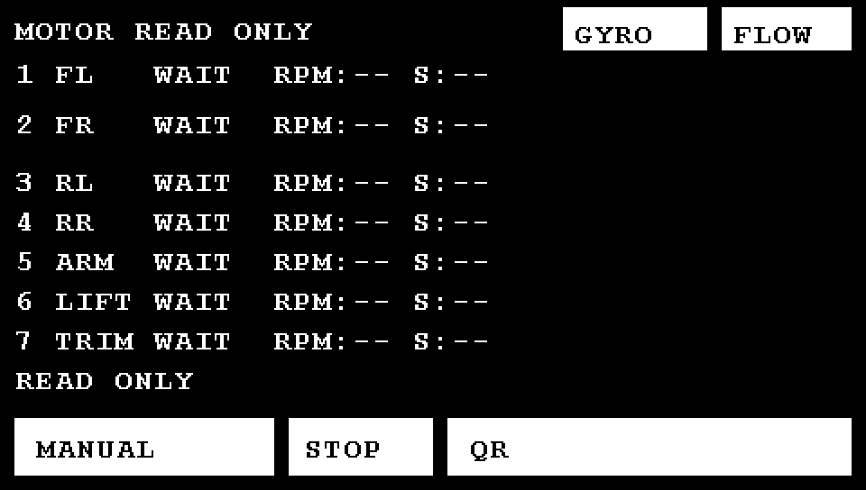
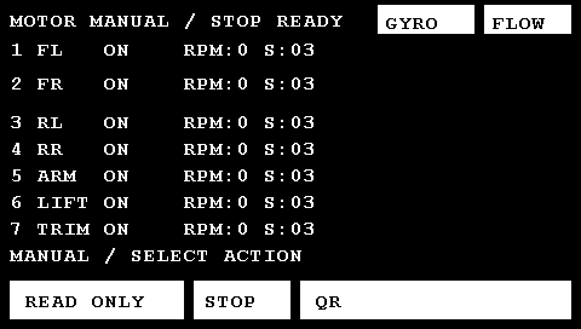
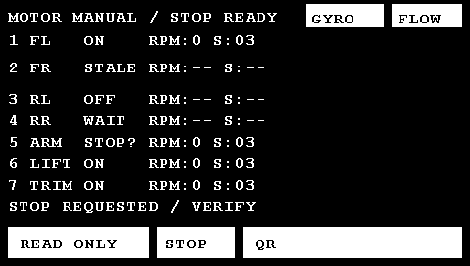
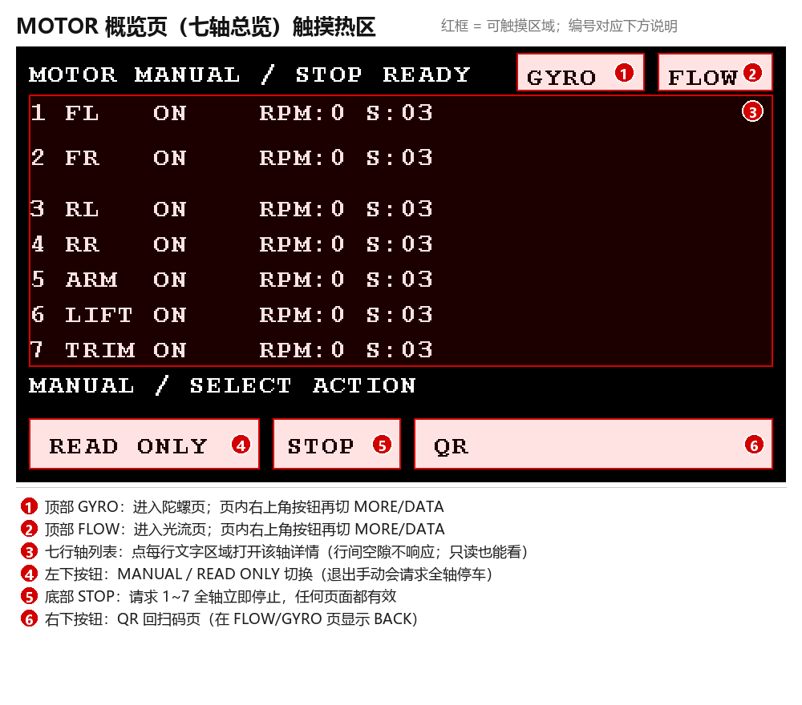
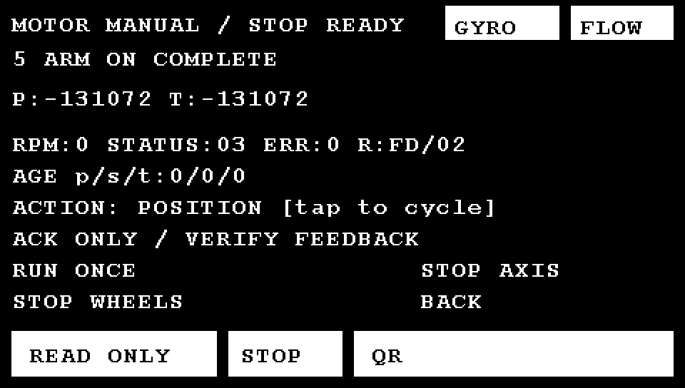
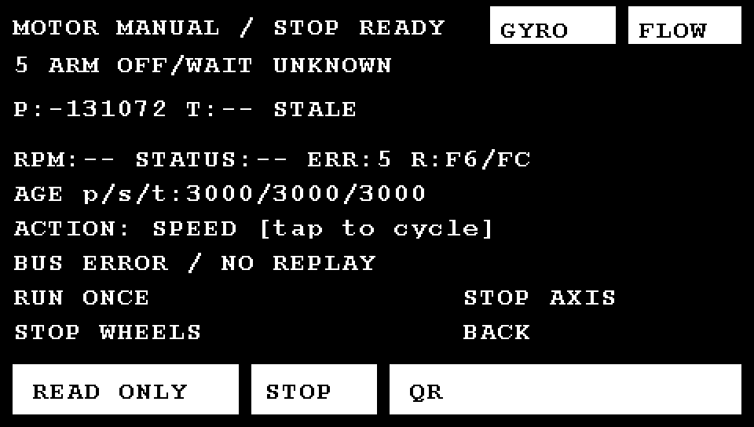
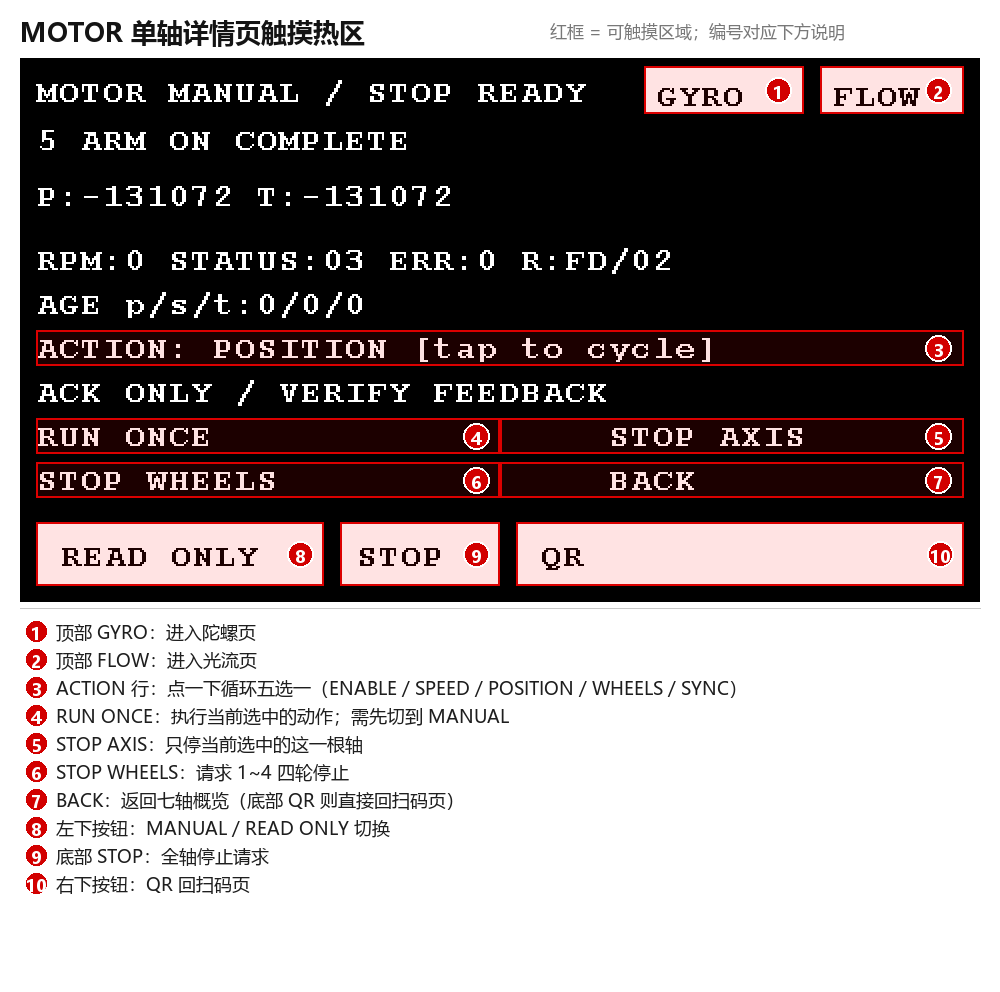

# 电机相关屏幕显示梳理（2026-10-23）

本文回答三个问题：

1. 屏幕上到底会显示电机的哪些内容？
2. 关于电机的页面长什么样？
3. 每个字段、每个状态词、每个按钮是什么意思？

> 基线：`main` 分支 `b3df329`。本轮只读代码并运行主机测试，未烧录、未接实物电机。
> 文中的页面图片不是物理屏拍照，而是用工程自己的 480×272 像素级 LCD 替身 + 真实 Font16 字库逐像素渲染出来的，布局、坐标、字符串与当前代码一致（见第 10 节）。

---

## 0. 先给结论

- 屏幕上与电机有关的只有 **一个页面 + 一个详情视图**：
  - **MOTOR 概览页**（七轴总览，7 行轴数据）；
  - **MOTOR 单轴详情页**（点概览任意一行进入）。
- 除此之外，电机信息还会以三种方式出现在别处：
  - 所有页面底部都有 **STOP（全轴停止）** 按钮；
  - MOTOR 页底部消息行显示电机总线最近一次事件（上电测试进度、拒绝原因、停止请求等）；
  - GYRO 页的 `CAL:` 行会显示 `MOTOR ACTIVE` / `MOTOR UNKNOWN` / `STOP UNCONF`，表示"因为电机状态不满足，陀螺校准被拒绝"。
- 屏幕上的电机数据全部来自 **Emm 协议反馈**：速度（RPM）、位置（编码器计数，65536/圈）、状态字节（含使能/到位/堵转/保护位），**不是**电流、温度、电压或毫米坐标。
- 默认构建（`MOTOR_BOOT_SEQUENCE_ENABLED=0`）上电不自动让电机转：进 MOTOR 页先是 `MOTOR READ ONLY`，七行都是 `WAIT`，收到反馈后变成 `ON`；要动必须切 `MANUAL`。
- 电机页所有文字都是 **英文 ASCII**（字库只有 ASCII 点阵），这是屏幕上看不到中文解释的原因。

页面总览：

| 页面 | 进入方式 | 内容 | 与电机的关系 |
|---|---|---|---|
| QR（默认页） | 上电默认 | 扫码会话/任务码/统计 | 右下角 `MOTOR` 进入电机页；底部 `STOP` 停全轴 |
| **MOTOR 概览** | QR 页点右下 `MOTOR` | 七轴：地址/角色/状态/RPM/状态字节 + 消息行 | 本体 |
| **MOTOR 详情** | 概览页点第 1~7 行 | 单轴位置/目标/速度/状态/错误/结果/字段年龄 + 动作模板 | 本体 |
| FLOW | QR/MOTOR 页点右上 `FLOW` | 光流 counts 与诊断 | 只有 `STOP` 与返回按钮 |
| GYRO | 任意页点右上 `GYRO` | 角速度/相对角/校准 | `CAL:` 行显示电机导致的校准拒绝原因 |

页面是"叠层"关系：`motor_page`、`flow_page`、`gyro_page` 可以同时为 1，显示优先级是 GYRO → FLOW → MOTOR → QR；右下宽按钮（`BACK`/`QR`）逐层退出。例如从 MOTOR 进 FLOW 再退，会回到 MOTOR，而不是回 QR。

---

## 1. 屏幕与排版基础

| 项目 | 值 |
|---|---|
| 分辨率 | 480×272，ARGB8888，LTDC + DMA2D，显存在外部 SDRAM |
| 配色 | 黑底白字；按钮为白色实心矩形 + 黑色文字 |
| 字体 | Font16 = 11×16 像素；只有 QR 页第 2 行（任务码）用 Font24；MOTOR 页全部 Font16 |
| 9 行文本的 Y 坐标 | `8, 32, 60, 92, 114, 136, 158, 180, 202`（`qr_ui.c` 第 14 行） |
| 标题 | 第 0 行，x=8，最多 26 个字符（296 px 宽，右上按钮从 x=312 开始） |
| 正文 | 每行最多 42 个字符（42×11=462 px） |
| 刷新方式 | 先冻结 9 行快照，再用可取消的状态机每轮画"一条 480×4 的条带"或"最多 2 个字符"；≥100 ms 才取新快照（`qr_ui.c` 第 244–267 行） |

因此：**屏幕不是实时示波器**。数值大约每 0.5 s 更新一次（具体见第 6 节），且一次刷新是分多个主循环"慢慢画出来"的，属正常现象。

---

## 2. MOTOR 概览页（七轴总览）

### 2.1 上电默认样子（只读、尚未收到反馈）



### 2.2 手动模式、七轴在线



### 2.3 五种状态同屏示例



### 2.4 逐行含义

| 行 | 内容 | 说明 |
|---|---|---|
| 0 | `MOTOR READ ONLY` 或 `MOTOR MANUAL / STOP READY` | 标题。`READ ONLY` = 界面不允许发起测试动作（但底部 STOP 永远可用）；`MANUAL` = 已切换手动，可以选动作执行 |
| 1~7 | `1 FL   ON    RPM:0 S:03` 这样的七行 | 地址 1~7 各一行，格式 `地址 角色 状态 RPM:转速 S:状态字节` |
| 8 | `READ ONLY` / `STOP REQUESTED / VERIFY` … | **电机总线最近一次事件消息**，不是实时健康状态；42 字符截断 |

### 2.5 每个字段

| 字段 | 例子 | 来源 | 含义 |
|---|---|---|---|
| 地址 | `1`…`7` | 固定节点表 | 1 前左、2 前右、3 后左、4 后右、5 旋转臂、6 升降、7 前后微调 |
| 角色 | `FL`/`FR`/`RL`/`RR`/`ARM`/`LIFT`/`TRIM` | `MotorBus_Role()` | 上表对应的英文缩写 |
| 状态 | `ON`/`STALE`/`OFF`/`WAIT`/`STOP?` | 在线标志 + 各字段新鲜度 | 见 2.6 |
| `RPM:` | `0`、`-12`、`--` | Emm 速度反馈 0x35 | 带符号转速，单位 RPM；`--` = 当前没有**新鲜**速度值（不是 0） |
| `S:` | `03`、`01`、`--` | Emm 状态反馈 0x3A | 状态字节原样两位十六进制；`--` = 没有新鲜状态；位含义见 2.7 |

注意：`RPM:--` 不等于"没转"，`S:--` 也不等于"没故障"——只表示这一路反馈这一时刻不新鲜/没收到。

### 2.6 五个状态词（重要）

代码在 `qr_ui.c` 第 127–136 行按以下优先级计算：

| 显示 | 条件（源码顺序） | 含义 | 常见原因 |
|---|---|---|---|
| `STOP?` | `n->stop_unconfirmed` | 已经请求停止，但还没有被**新的**零速 + 无堵转/保护状态反馈确认 | 停止命令已发、电机仍在减速/堵转/反馈丢失；3 s 后仍未确认会转 UNKNOWN，但 `STOP?` 继续保留并重试 |
| `ON` | 在线，且速度、状态都新鲜 | 链路正常，速度/状态可信 | 正常状态（即使转速为 0 也显示 ON） |
| `STALE` | 在线，但速度或状态至少一路不新鲜 | 收到过数据、链路还在，但部分反馈过期 | 轮询变慢、串口偶发错误、某类查询连续失败 |
| `OFF` | 不在线，但 `rx_count>0` | 曾经收到过该地址数据，现在链路失效 | 断线、掉电、UART 错误后未恢复、地址冲突 |
| `WAIT` | 不在线且 `rx_count==0` | 上电以来**从未**收到该地址的有效应答 | 没接电机、电机没上电、地址不是 1~7、A/B 线接反、UART5 未通 |

"在线"由总线维护：任何被接受的应答置 `online=1`；超过 1600 ms 没有新应答则在 `monitor()` 里清 0（`motor_bus.c` 第 450–452 行）。

### 2.7 状态字节 `S:` 的位

代码中实际使用的位（`motor_bus.c` 第 52、458、495、511 行；旧单机页 `motor_ui.c` 第 83–90 行）：

| 位 | 掩码 | 代码中的用途 | 含义 |
|---|---|---|---|
| bit0 | `0x01` | `healthy()` 要求"已使能"；停止确认要求速度=0 且该位按需 | 驱动器已使能（有保持力矩） |
| bit1 | `0x02` | 位置动作完成条件之一 | 位置到位 |
| bit2 | `0x04` | 与 bit3 合为 `0x0C`：有该组合就判故障/禁止运动 | 堵转/失步类故障（旧页显示 STALL） |
| bit3 | `0x08` | 同上 | 保护/故障（旧页显示 PROTECT） |
| bit4~7 | — | 代码不解释 | 原样显示，需对照 X42S/Emm 手册 |

例：

- `S:03` = `0x03` = 使能 + 到位（最常见的静止待命状态）；
- `S:01` = 使能但未到位；
- `S:00` = 未使能；
- `S:--` = 没有新鲜状态，不能据此判断。

### 2.8 底部消息行常见内容

消息行是 `MotorBus.message`，只记录"最近一次写入的事件"，不会自动过期。常见值分类如下（完整字符串见代码）：

| 类别 | 典型文本 | 什么时候出现 |
|---|---|---|
| 模式 | `READ ONLY`、`MANUAL / SELECT ACTION`、`READ ONLY / STOP VERIFY` | 初始化、切换只读/手动 |
| 排队/受理 | `QUEUED`、`WHEELS QUEUED`、`SYNC PREPARE`、`ACK ONLY / VERIFY FEEDBACK`、`GROUP ACK1 / VERIFY EACH`、`SYNC TRIGGER ACK / VERIFY` | 动作已入队或只收到 ACK，**都还不代表到位** |
| 条件不满足 | `MANUAL REQUIRED`、`NEED FRESH HEALTHY STATUS`、`NEED IDLE ENABLED HEALTHY AXIS`、`INVALID MOTION PARAMETERS`、`QUEUE FULL`、`AXIS BUSY`、`STOP PENDING`、`WHEELS NOT READY`、`SYNC BUSY`、`SYNC LOCKED / BUSY`、`CONFIGURE: POSITION/GROUP/SYNC`、`CONFIGURE motor_test_config.h`、`POSITION: SELECT AXIS 5..7`、`REQUEST EXPIRED / NOT SENT`、`EXPIRED WHEEL VECTOR` | 点了动作但被安全检查/配置拒绝 |
| 停止/故障 | `STOP REQUESTED / VERIFY`、`BUS ERROR / NO REPLAY`、`ACK TIMEOUT / STOP VERIFY`、`TRANSPORT ERROR / STOP VERIFY`、`LIMIT / NO MOTION (12/22)`、`E2 CONDITION/PARAM REJECTED`、`EE FORMAT REJECTED`、`SYNC CACHE UNKNOWN / LOCKED`、`UNKNOWN RECOVERED / STOPPED`、`UNKNOWN RECOVERED / IDLE` | 停止重试、通信错误、电机拒绝、缓存/同步问题 |
| 上电四轮测试（默认关闭） | `BOOT 1-4 WAIT FEEDBACK`、`BOOT 1-4 ENABLING`、`BOOT 1-4 STARTING`、`BOOT 1-4 STOPPING / VERIFY`、`BOOT 1-4 DONE / READ ONLY`、`BOOT 1-4 ABORTED / STOP VERIFY` | 仅 `MOTOR_BOOT_SEQUENCE_ENABLED=1` 的测试构建 |

### 2.9 触摸热区



- 点第 1~7 行每一行的文字区域 → 打开该轴详情（**只读模式下也能看**；行与行之间的空隙不响应）。
- 左下 `MANUAL` / `READ ONLY`：切换手动模式；从手动切回只读会请求 **1~7 全轴停止**。
- 底部 `STOP`：请求 1~7 全轴停止，任何页面都有效。
- 右下 `QR`：回扫码页。
- 右上 `GYRO` / `FLOW`：进入对应页面（叠在电机页之上，返回后仍回电机页）。

---

## 3. MOTOR 单轴详情页

### 3.1 正常示例（5 号轴，手动、位置动作已完成）



### 3.2 掉线/过期示例



### 3.3 逐行含义

| 行 | 屏幕内容（示例） | 字段 | 含义 |
|---|---|---|---|
| 0 | `MOTOR MANUAL / STOP READY` | 标题 | 与概览页同一标题，不额外提示"这是详情" |
| 1 | `5 ARM ON COMPLETE` | 地址 + 角色 + `ON`/`OFF/WAIT` + 动作状态 | 动作状态是**软件事务状态**，不代表物理反馈。`STOP UNCONF` 会替代动作名显示 |
| 2 | `P:-131072 T:-131072` / `P:-131072 T:-- STALE` | P=实际位置，T=本次目标位置 | 单位都是**编码器计数**（65536 计数/圈）；`T:--`=本程序尚未建立已知目标；尾部 `STALE`=位置反馈已过期（但旧值仍显示） |
| 3 | `RPM:0 STATUS:03 ERR:0 R:FD/02` | 速度、状态字节、错误码、最后命令码/结果码 | RPM、STATUS 只有**新鲜**时才显示数值，否则 `--`；ERR 是数字枚举；R 是"十六进制命令码 / 十六进制结果码" |
| 4 | `AGE p/s/t:0/0/0` | 位置/速度/状态三个字段的数据年龄（ms） | 从未收到过该字段显示 `99999`；数字超过 1600 就说明该路已过期 |
| 5 | `ACTION: POSITION [tap to cycle]` | 当前选中的测试模板 | 点这一行循环切换五选一 |
| 6 | `ACK ONLY / VERIFY FEEDBACK` | 总线消息 | 同概览页第 8 行 |
| 7 | `RUN ONCE ... STOP AXIS` | 左=执行一次，右=只停当前轴 | **纯文字热点**，没有白色按钮底 |
| 8 | `STOP WHEELS ... BACK` | 左=停 1~4 四轮，右=返回概览 | 纯文字热点 |

> 注意：概览页会区分 `OFF`（曾通信、现已断链）与 `WAIT`（从未通信）；详情页第 1 行不区分，统一显示字面量 `OFF/WAIT`。

### 3.4 动作状态词（第 1 行）

来源 `MotorBus_ActionName()`（`motor_bus.c` 第 37–42 行），完整取值：

| 显示 | 含义 |
|---|---|
| `IDLE` | 空闲 |
| `QUEUED` | 已入队，未发送 |
| `SENT` | 已提交给串口（不代表电机已执行） |
| `ACK ONLY` | 只收到电机 ACK，尚未用反馈验证 |
| `EXECUTING` | 已从反馈中看到正在执行（速度/位置在变化） |
| `COMPLETE` | 位置到位（误差 ≤128 计数、速度=0、到位位=1）或使能确认 |
| `REJECTED` | 电机拒绝或参数/条件不满足 |
| `UNKNOWN` | 超时/传输故障，无法确认结果；运动被禁止，需新反馈恢复 |
| `CANCELLED` | 被停止请求或故障取消 |
| `STOP UNCONF` | 停止未确认（详情页用这个词；概览页对应 `STOP?`） |
| `STOPPED` | 停止已被新反馈确认 |

### 3.5 错误码 `ERR:`（数字枚举）

| 数字 | 枚举 | 含义 |
|---|---|---|
| 0 | `MOTOR_ERROR_NONE` | 无错误 |
| 1 | `MOTOR_ERROR_TIMEOUT` | 应答超时 |
| 2 | `MOTOR_ERROR_REJECTED` | 电机拒绝 |
| 3 | `MOTOR_ERROR_FORMAT` | 帧/格式错误 |
| 4 | `MOTOR_ERROR_RX_OVERFLOW` | 接收溢出 |
| 5 | `MOTOR_ERROR_UART` | UART 传输错误 |
| 6 | `MOTOR_ERROR_MOTION_TIMEOUT` | 运动超时 |
| 7 | `MOTOR_ERROR_STALL` | 堵转/保护 |

### 3.6 结果码 `R:命令/结果`

- 命令码：`F3`=使能、`F6`=速度、`FD`=位置、`FE`=停止。
- 结果码：`02`=ACK OK、`12`/`22`=限位/无法运动、`E2`=条件或参数拒绝、`EE`=格式拒绝、`FC`=传输层失败、`FF`=超时；`9F` 是异步到位通知，**不作为**命令 ACK。
- 例：`R:FD/02` = 最近一次控制是位置命令，电机回 ACK OK；`R:F6/FC` = 最近一次速度命令在传输层失败。

### 3.7 五个动作模板（`ACTION:` 行）

数组定义在 `qr_ui.c` 第 120 行：

| # | 显示 | 实际动作 | 默认构建能否执行 |
|---|---|---|---|
| 0 | `ENABLE` | 给当前轴发使能（不运动） | 可（需新鲜健康状态） |
| 1 | `SPEED` | 10 RPM、加速度 100、租约 1000 ms 的点动（租约到期按运动超时请求停止） | 可（`MOTOR_BENCH_JOG_ENABLED=1`），需已使能 + 新鲜健康反馈 |
| 2 | `POSITION` | 32 脉冲、模式"相对当前实际位置"、8 s 超时；只允许 5~7 轴 | **默认不可**（`MOTOR_TEST_CONFIGURED=0`，且 `MOTOR_TEST_PULSES_PER_REV=0`） |
| 3 | `WHEELS 0xAA` | 四轮 `{10,-12,14,-16}` RPM 的 0xAA 聚合帧 | **默认不可** |
| 4 | `SYNC WHEELS` | 四轮缓存同步 + FF 触发 | **默认不可**（且同步缓存默认锁定） |

注意：

- 这五个是**台架测试模板**，不是比赛动作接口；比赛动作应走 `MotorBus_Submit/Wheels/Sync` 或后续行为层。
- UI 允许你循环到 POSITION/WHEELS/SYNC，但按 `RUN ONCE` 只会得到 `CONFIGURE: POSITION/GROUP/SYNC` 之类的消息，不会动。
- `RUN ONCE` 只在 `MANUAL` 下执行；只读时按了不会有反应，第 7 行会提示 `MANUAL REQUIRED`。
- 每个动作都有前置条件：轴在线、状态新鲜、无堵转/保护、已使能、无未确认停止、轴空闲；不满足就只更新消息行。

### 3.8 停止未确认（`STOP UNCONF` / `STOP?`）

- 按 `STOP`/`STOP AXIS` 只是"提交停止意图"，**不等于已经停住**。
- 确认条件：首次 STOP 发出之后，新取得的、仍新鲜的速度反馈为 0，且状态无堵转/保护位（`motor_bus.c` 第 453–460 行）。
- 3 s 内没确认：动作状态转 `UNKNOWN`，但停止意图和重试继续保留（首次两次快速重试至少间隔 200 ms，之后至少 1 s 一次）。
- 所以看到 `STOP?` / `STOP UNCONF` 时，要看电机是否真的减速停住、反馈是否恢复；必要时人工断电或处理机械/通信问题。
- `STOP` **不会自动失能**，尤其 6 号升降轴不用失能代替停止。

### 3.9 触摸热区



- 只有按下边沿触发，按住不重复；第二根手指不会制造新点击。
- 点 `ACTION:` 行循环五选一；其余空白行（如第 2~4 行）没有动作。
- 底部按钮与概览页相同：`READ ONLY`/`MANUAL`、`STOP`、`QR`。

---

## 4. 怎么进出、怎么操作

| 目标 | 操作 |
|---|---|
| 从扫码页看电机 | 点底部右侧 `MOTOR` |
| 看某根轴详情 | 在概览页点对应的第 1~7 行 |
| 返回概览 | 详情页点 `BACK`（第 8 行右半），或底部 `QR` 直接回扫码页 |
| 进入手动 | 概览/详情页点左下 `MANUAL`；标题变 `MOTOR MANUAL / STOP READY`，左下按钮变 `READ ONLY` |
| 执行测试动作 | 进详情 → 点 `ACTION:` 选模板 → 点 `RUN ONCE`（仅 ENABLE/SPEED 在默认构建可用） |
| 急停 | 任意页面底部 `STOP`（1~7 全轴），或详情页 `STOP AXIS`、`STOP WHEELS` |
| 切到光流/陀螺 | 在 QR 或 MOTOR 页点右上 `FLOW` / `GYRO`；从电机页进入时，它们的 `BACK` 回到电机页 |
| 回扫码页 | 点右下 `QR` |

重要细节：

- **上电默认在 QR 页**，不是电机页。
- 电机通信、轮询、停止重试和故障处理在后台一直运行，**与当前显示哪页无关**；切页只影响显示。
- 从手动切回只读会请求全轴停止；在电机页点任何动作按钮（MODE/RUN/STOP 类）都会取消正在进行中的四轮上电测试。
- 底部 `STOP` 的触摸区是 x=160~239、y=232~263；右上 `GYRO` 是 x=312~391、y=4~27；右上 `FLOW` 是 x=400~471、y=4~27；右下 `QR/BACK` 是 x=248~471、y=232~263（`qr_ui.c` 第 36–55 行）。

---

## 5. 代码分层：这些数字从哪来

```
Emm 电机（X42S_V2.0，115200 8N1，地址 1~7）
        │  UART5：PC12 TX / PD2 RX，DMA1 Stream0/7
        ▼
bsp_motor_uart.c    收发字节、DMA/环形队列、错误隔离与恢复
        ▼
emm_protocol.c      组帧/解帧：0x35 速度、0x36 位置、0x3A 状态、F3/F6/FD/FE 控制
        ▼
motor_bus.c         七节点调度：单活动事务、轮询、ACK、反馈验证、停止确认、UNKNOWN
        │  MotorSnapshot：position_counts / speed_rpm / status_flags / *_ms / valid
        ▼
qr_app.c            编排：先跑总线再画 UI；触摸动作转成 MotorBus API
        ▼
qr_ui.c             motor_page()：把快照格式化成 9 行文本，再分步画到屏幕
```

- 协议层与硬件无关：`emm_protocol.c` 只负责构造/解析帧，不等待 ACK。
- 总线层是唯一 UART5 写者：同一时刻只允许一个在线事务；最小命令间隔 10 ms，应答期限 60 ms，取消/超时隔离 120 ms。
- 单机 `motor_service.c` / `motor_demo.c` / `motor_ui.c` 是**旧的单电机演示实现**，`main.c` 不调用；当前统一界面由 `qr_ui.c` 负责。
- `MotorSnapshot` 定义在 `motor_types.h`：`valid` 三位分别表示位置/速度/状态是否曾经收到；每个字段有独立时间戳 `*_ms` 和序号 `*_seq`。

### 5.1 关键文件与入口

| 内容 | 位置 |
|---|---|
| 页面/9 行格式化/绘图状态机 | `User/app/qr_ui.c`（概览页 118–159，详情页 140–158，热区 31–71，绘图 182–239） |
| 应用编排、上电测试、触摸分发 | `User/app/qr_app.c`（手动动作 106–162，上电测试 16–100） |
| 七轴总线/状态机 | `User/motor/motor_bus.c`、`motor_bus.h` |
| 快照结构/错误枚举 | `User/motor/motor_types.h` |
| 测试配置宏 | `User/motor/motor_test_config.h` |
| Emm 协议 | `User/motor/emm_protocol.c/h` |
| UART5 BSP | `User/usart/bsp_motor_uart.c` |
| 主循环 | `User/main.c` 19–43 |
| 旧单机页（未使用） | `User/app/motor_ui.c` |

---

## 6. 刷新、新鲜度与"为什么数值看起来慢/旧"

| 参数 | 值 | 作用 |
|---|---|---|
| 每轴每字段轮询目标 | 约 500 ms（运动中速度/5~7 轴位置可到 200 ms） | 屏幕数值的实际更新节奏主要受此限制 |
| 总线最小命令间隔 | 10 ms | 同一时刻只有一个事务 |
| 应答期限 | 60 ms | 超时即重试/失败 |
| 取消/超时隔离 | 120 ms | 超时后静默窗口，避免迟到应答串线 |
| 新鲜度阈值 | 1600 ms（`MOTOR_BUS_FRESH_MS`） | 超过即 `STALE` / `--`；在线标志也在此期间清零 |
| UI 取快照 | ≥100 ms | 只决定"画面多久请求一次新数据"，不改变总线轮询 |
| 单帧绘制预算 | 1 条 480×4 条带或 2 个字符 | 保证不长时间占用主循环 |

因此：

- 一屏七行不是同一毫秒的七次采样，而是"最近各自收到的一次"；每行可能相差几十~几百 ms。
- 详情页 `AGE p/s/t:` 就是给这个用的：三个字段各自的年龄。
- 如果 `AGE` 已经大于 1600，而 `P` 还显示数字，那是"旧值 + STALE"，不能当当前位置用。
- 如果 `RPM`/`STATUS` 显示 `--`，是"没有新鲜值"，不是 0/无故障。
- 触摸扫描最多 20 ms 一次，且只在"按下边沿"处理，所以按住不会连续触发。

---

## 7. 电机"会动"相关的语义要点

1. **默认不会动**：`MOTOR_BOOT_SEQUENCE_ENABLED=0`，上电只读。只有显式切 MANUAL 并执行测试动作才动；`MOTOR_TEST_CONFIGURED=0` 时还只开放 ENABLE 和 10 RPM 点动。
2. **ACK 不等于执行**：只有反馈（位置/速度/状态）才能证明到位或停止；界面上的 `ACK ONLY / VERIFY FEEDBACK` 就是提醒这一点。
3. **不自动重放**：速度/位置动作超时或总线错误后不会自动重发，只会请求停止并保留证据；位置/速度模式需要重新提交。
4. **位置模式三种**：相对上一输入目标、相对坐标零点、相对当前实际位置；上一次目标未知时对应模式会被拒绝。
5. **同步缓存默认锁定**：`MOTOR_SYNC_CLEAN_BOOT_CONFIRMED=0`，`SYNC WHEELS` 不可用；MCU 复位不能证明电机缓存干净。
6. **`UNKNOWN` 不阻塞手动观察**：详情页会显示 `UNKNOWN`，概览页仍按反馈显示 ON/STALE/OFF/WAIT；有新的零速+无故障反馈并过了稳定窗（500 ms）后可自动恢复为 `STOPPED`/`IDLE`，但未确认的 STOP 不会被自动清掉。
7. **单位**：速度=RPM；位置=编码器计数（65536/圈）；目标计数由"脉冲数 × 65536 / 每圈脉冲数"换算。**没有**毫米、角度、轮速或车体坐标换算。

---

## 8. 其他页面上的电机信息

### 8.1 QR 页

- 底部右侧 `MOTOR`：进入电机概览页。
- 底部 `STOP`：全轴停止（任何页面都有）。
- QR 页本身不显示电机数值。

### 8.2 GYRO 页

陀螺校准要求"电机静止/已确认停止"。被拒绝时，`CAL:` 行会显示与电机相关的原因（`gyro_service.c` 第 273 行、`gyro_ui.c` 第 48 行）：

| 显示 | 含义 |
|---|---|
| `CAL:MOTOR ACTIVE` | 有轴在运动、有排队动作、同步进行中，或速度反馈非 0 |
| `CAL:MOTOR UNKNOWN` | 某轴无新鲜反馈/不在线/有故障位，无法证明静止 |
| `CAL:STOP UNCONF` | 有轴停止未确认 |

这些是"校准被拒原因"，不是电机实时测量值；`CAL:OK` 也不等于机械绝对静止。

### 8.3 FLOW 页

除底部 `STOP` 和返回按钮外，不显示电机信息。

---

## 9. 不在屏幕上的内容 / 容易误解的地方

| 项目 | 说明 |
|---|---|
| 电流、温度、电压、母线电压 | 本工程不读取、不显示 |
| 固件/硬件版本 | 节点里有 `firmware/hardware/version_valid`，可用 `MotorBus_ReadVersions()` 读取，但统一界面不显示，只能调试器看 |
| 限位、零点、机械行程 | 未实现；`POSITION` 只是相对测试，不代表机械绝对位置 |
| 毫米/角度/轮速/里程计 | 未标定；屏幕只有 counts 和 RPM |
| RX/TX/坏帧/超时计数 | 旧单机页显示，统一界面不显示；调试器可看 `MotorBus` 统计 |
| 电机是否"真的转" | 界面只能通过速度/位置反馈间接判断；`ON` 只代表链路/字段新鲜 |
| 中文 | 字库只有 ASCII，界面全英文 |
| 旧截图里的 `MOTOR MANUAL - STOP ALWAYS AVAILABLE` | 那是 `0a2354e` 之前的旧界面标题，当前已改为 `MOTOR MANUAL / STOP READY`；`Output/host-tests` 下的旧 PNG 是历史预览，勿当现状 |
| 旧 12 行单电机页 | `User/app/motor_ui.c` 仍保留（`X42S Emm - Motor telemetry`、POS 以度显示、ENABLE/IN POS/STALL/PROTECT、RX/TX/BAD、TOUCH 等），但 `main.c` 不调用，仅主机测试引用 |

---

## 10. 这份文档里的图片怎么来的

- 页面图片来自工程现有的主机测试 LCD 替身：`Tests/test_qr.c` 第 214–263 行把 `LCD_DisplayStringAt()` 按 **真实 Font16 字库点阵**逐像素写进 480×272 缓冲区，再导出 PGM；`Scripts/test.ps1` 每次运行都会重新生成 `Output/host-tests/motor_*.pgm`。
- 本文把 PGM 转成 PNG，并额外用 `Output/host-tests/preview_motor.c`（Git 忽略、不进固件）构造了"正常详情""掉线详情""混合状态"三个场景，仍调用真实 `QrUi_Process()` 渲染。
- 触摸热区图是在真实渲染图上叠加红框和编号，坐标直接取自 `QrUi_Touch()`。
- 所以这些图能准确代表**代码会画成什么样**；但它们不是实物屏照片，也不代表实际 LCD 时序/亮度/可视角度。

本轮验证：

- 在 `b3df329` 上运行 `.\Scripts\test.ps1`，全部主机测试通过（QR 18435 项、总线 7543 项、UART5 24 项、上电测试 82535 项等），退出码 0。
- 未烧录、未接实物电机；实物屏幕和电机反馈仍需按 README 的验收边界另行确认。

---

## 11. 快速读屏清单

1. **先看标题**：`READ ONLY` 还是 `MANUAL`。
2. **看七行状态**：
   - `WAIT` → 从未收到该地址应答，先查接线/供电/地址/波特率；
   - `OFF` → 曾经通过信，现在断链，查线/干扰/UART 错误；
   - `STALE` → 还在线但反馈变慢，看 `AGE`；
   - `STOP?` → 停止未确认，确认机械是否停住、反馈是否恢复；
   - `ON` → 正常。
3. **点开某行看详情**：`P/T`（counts）、`RPM`、`STATUS`、`ERR`、`R`、`AGE`。
4. **要动**：切 `MANUAL` → 选轴 → 选 `ACTION` → `RUN ONCE`；默认只放行 ENABLE 和 10 RPM 点动。
5. **任何异常先看底部消息行**：它是最近一次总线事件的"一句话解释"。
6. **急停**：任意页底部 `STOP`；看到 `STOP?` 不要假设已经停住。
