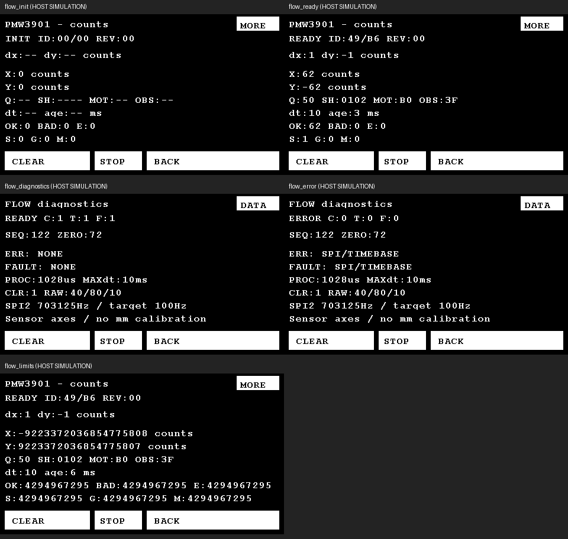

# PMW3901 光流：接线、软件交付与联调

2026-10-21。已在野火 F429 HAL 1.7.3 / Keil AC5 现有 QrApp 中完成采集、累计、状态、FLOW 页和异常恢复。代码验收提交 `5165f38`；交付分支 `feature/pmw3901-flow`，工作目录 `E:/工创赛/迁移野火板-光流`。

**软件验证已完成，未烧录，未接实物，未确认真实 ID/运动方向/采样抖动/定位精度。所有单位为 counts；没有 mm 换算或闭环控制。**

## 1. 并行基线与集成

- 起点 `19a888b`；建立独立 Git worktree，未在主工作区开发。接手时 main 没有源码差异，仅有未跟踪的任务书，原文件原样保留。
- 光流驱动/服务提交 `0ab6624`，SPI2 BSP 提交 `704056b`；期间 main 前进到 `da96ca9 放宽电机安全门控`，已通过 `78ecf68` 合并到本分支，之后才小块修改共享应用/UI。
- 集成提交 `a24f1f0`，并行/退避测试与原始快门语义复核提交 `5165f38`。本分支包含 main 最新电机行为；不把光流驱动单独通过当作交付。
- 与 `da96ca9` 比较，`User/motor/*`、UART5/USART3/扫码触发、`main.c`、`app_runtime.*`、HAL 配置、启动文件均无光流改动。main 分支和主工作区未被切换、回写或提交。
- 默认保留 `MOTOR_BOOT_SEQUENCE_ENABLED=1`、四轮依次使能/10RPM启动/停止，以及 `da96ca9` 放宽后的驱动门控和手动点动。FLOW 只测量；CLEAR、切页、初始化/失败/恢复不调用电机控制。FLOW 的 STOP 明确复用原全体 STOP。

## 2. 软件选定接线（图纸核对，实物尚未接线）

依据为用户目录的模块原理图/图片，以及野火 **挑战者 V1 核心板**原理图第 1 页 J7/J45、第 2 页 MCU 网络。采用硬件 SPI2，PB13/PC2/PC3 为 AF5；CS 独立 GPIO PE3。未移动任何现有外设。

**MIS/MOS 有资料歧义：** 原理图 JP1-3=MOSI、JP1-5=MISO；附图第三脚却写 MIS 并称“输入”，第五脚写 MOS 并称“输出”。不能仅按 MIS 常见缩写直接接线。接实物前按实际板版本/走线或通断测量确认：连芯片 **16(MOSI) 的模块输入**接 MCU PC3；连芯片 **18(MISO) 的模块输出**接 MCU PC2。若实物与下表编号不同，以已确认的信号方向为准。未完成此项之前，下表不代表实物排针已验证。

| 模块信号/资料丝印 | 模块原理图 JP1 | MCU | V1 核心板 | 方向/设置 |
|---|---:|---|---|---|
| VCC / 3V3 | 1 | 3.3V 电源 | J45-1（也可 J45-3） | 电源输出到模块；不能用 5V |
| GND | 2 | GND | J45-5（或 J45-6） | 共地 |
| MOSI / 图片第三脚 MIS（输入，须核实） | 3 | PC3 | J7-52 | MCU 输出，SPI2_MOSI AF5 |
| SCLK / CLK | 4 | PB13 | J7-54 | MCU 输出，SPI2_SCK AF5，空闲高 |
| MISO / 图片第五脚 MOS（输出，须核实） | 5 | PC2 | J7-16 | MCU 输入，SPI2_MISO AF5，上拉 |
| CS | 6 | PE3 | J7-49 | 普通推挽输出，低有效，先置高再配置输出 |
| RESET / RST | 7 | 不接 MCU | 无 | 依赖模块图中 4.7k 上拉至 3.3V；启动执行 0x3A=0x5A 软件复位 |
| MOT / MOTION | 8 | 不接 | 无 | 本版轮询，不分配 EXTI |
| VREG / VRE | 9 | 不接 | 无 | 芯片内部电压输出，不能外部供电 |

模块图中 VCC 经板载 1.8V 稳压器供芯片 VDD，同时直接接 VDDIO，故使用 3.3V 供电/逻辑。板上有稳压器不代表接受 5V。接线前断电，核对排针 1 脚方向，避免把相邻 J7-14 的 PB12 扫码触发误当光流 CS。

现有占用保持：UART5 PC12/PD2 和 DMA1 Stream0/7；USART3 PB10/PB11 和 DMA1 Stream1；扫码 TRIG PB12；USART1 PA9/PA10；触摸 PH4/PH5/PD11/PD13；LCD/LTDC、FMC/SDRAM 全部引脚；Flash SPI5 PF7/PF8/PF9、PF6 CS。SPI4 PE5/PE6 为 LCD G0/G1，SPI2 常用 PB14/PB15 又连 USB Micro，本版均避开。PC2/PC3/PE3 当前 BSP 无其它用途；只有核心板，未连接另一个使用这些线的扩展板这一前提仍需实物核实。

SPI2 输入为 APB1 **45MHz**，不是 SYSCLK 180MHz；分频 64 后 **703125Hz**。Mode 3（CPOL=1、CPHA=1）、8bit、MSB first、软件 CS、双线全双工。HAL_SPI_MspInit 原由 Flash BSP 持有，现仅按 SPI2 分发到新增 BSP，SPI5 原路径保留。未引入 SPI DMA/中断或共享 UART 回调修改。

## 3. 资料补全、版本与取舍

用户目录目前只有两份 PDF、两张 WEBP。`CJMCU-3901 芯片手册.pdf` 为 Version 1.00 节选 11 页，印刷页码跳跃，最后仅有性能优化表开头，不能称为完整官方代码例程。模块 PDF 和图片用于电气/引脚核对。

| 补充来源 | 使用内容与边界 |
|---|---|
| [Bitcraze Arduino 固定版本](https://github.com/bitcraze/Bitcraze_PMW3901/blob/d322d98d6f61757352d11d922cd194539e165231/src/Bitcraze_PMW3901.cpp) | MIT。完整 73 次优化寄存器写入、页切换及中间 100ms 等待；与本地节选表开头逐项核对。原版权/许可完整保留在 pmw3901.c，详见 User/flow/THIRD_PARTY_NOTICES.md。 |
| [Crazyflie 固定版本](https://github.com/bitcraze/crazyflie-firmware/blob/137cc93f85692de1ee2ede3ded38247ca130f9db/src/drivers/src/pmw3901.c)及[接口](https://github.com/bitcraze/crazyflie-firmware/blob/137cc93f85692de1ee2ede3ded38247ca130f9db/src/drivers/interface/pmw3901.h) | 交叉核对 0x16 Motion Burst、12 字节顺序与快门端序；只据其公开线格式独立解析，不复制 LGPL 平台/RTOS/位域结构。 |
| [PixArt v1.40 公开 PDF，Bitcraze 托管](https://wiki.bitcraze.io/_media/projects:crazyflie2:expansionboards:pot0189-pmw3901mb-txqt-ds-r1.40-280119.pdf) | 实际也是 12 页公开节选，不是完整通信/初始化手册；核对 2MHz、电压、距离、寄存器，未虚称从它得到完整表。初始化缺口由上述固定 MIT 驱动补全。 |

没有拼接两套优化表：Arduino 与 Crazyflie 在页 0x14 的 0x65/0x63、页 0x15 的 0x48 等值及等待有差异；本版完全采用 Arduino 表（0x60、0x78、0x58；100ms），未采用 Crazyflie 的 0x67、0x70、0x48、10ms 或额外末尾写入。Arduino 的 4MHz SPI 则不符合本地 2MHz 上限，本版按保守时钟单独实现总线时序。

采集线格式：Motion、Observation、X低、X高、Y低、Y高、SQUAL、RawSum、RawMax、RawMin、Shutter上、Shutter下。X/Y 按二补码转 int16_t；快门保留原始 uint16_t，无未核实的位宽上限或物理单位。未用结构体强转、位域或两次读取拼同一份增量。

## 4. 初始化与实时行为

初始化仅配置 SPI 后立即返回应用；主循环按步骤执行：上电等待 40ms、CS 低/高各至少 1ms、软件复位等待 5ms、检查 Product=49/Inverse=B6 并记录 Revision、按 02→06 清读、等待 1ms、完整优化表逐项写入（中间 100ms）、末尾等待 50ms、复核身份、丢弃一份启动 Burst。之后才开放有效采样；正常主循环约数百毫秒完成，真实时间受显示/触摸影响。Revision 不设唯一门槛。

短事务：CS 低后等 50us；发读地址后等 50us（满足 tSRAD≥35us）；最后数据后保持 CS 至少 50us（写要求≥35us）；CS 高后写等待 200us、读等待 50us，覆盖写间隔≥45us、读后≥20us 与 burst 退出要求。每次 HAL_SPI_TransmitReceive 的超时为 1ms，地址失败即结束，不继续事务。错误也保持/释放 CS；下一轮重初始化仅复位 SPI2，不复位其它外设。

微秒等待使用 DWT CYCCNT，读取/相减为 uint32_t，可跨 32 位周期计数回绕；不复位 DWT 计数器，不改 SysTick，不关中断。若计数器停滞，有独立 100000 次循环上限，报告 SPI/TIMEBASE；初始化也检查计数器确实在前进。最长忙等指令仅 200us，其它毫秒等待均为状态机期限。

一次 Flow_Process 最多执行一项初始化写入或一次周期采样（必要时附 3 次 ID 读），不循环补采漏掉的周期。健康身份检查+Burst 线时序预算约 1.1ms；以 3ms 作为联调检查预算，MORE 的 PROC/MAXdt 实测值用于发现超预算。HAL 1ms 超时受 1ms Tick 量化，真实最坏耗时还受中断/调试停机影响，不保证硬实时。未连接传感器也不会阻止 QrApp 启动。

## 5. 数据、质量、清零和恢复

API 为 Flow_Init、Flow_Process、Flow_GetSnapshot、Flow_ResetTotals；快照仅在前台复制，无 ISR 读写 64 位总量。UI 不读芯片，不积分。后台采样目标 100Hz（10ms），显示沿用原 10Hz 和变化行重绘；切 QR/MOTOR 仍采集。

- C/comm_ok：初始化完成、SPI 成功且近期周期 ID 检查正常；HAL_OK 本身不能证明外设在线。每 500ms 验证身份，全零/全 FF Burst 立即报错。
- T/tracking：样本通过质量/状态判据，不以“位移非零”为必要条件。Motion 位未置且 dx=dy=0、质量合格时为有效静止；位未置却有非零增量或 RawMin>RawMax 则拒绝。
- F/fresh：有成功 Burst 且年龄≤100ms。首次未取得样本显示 -- / STALE；旧诊断量可保留，但不能成为当前有效测量。有效标志还要求 READY、跟踪合格且未累计溢出。
- **FLOW_MIN_SQUAL=25 是明确待实测的保守调试阈值，不是本地节选手册规定的精度门槛。** 本版拒绝所有 SQUAL<25 样本，保留真实 Q/SH/MOT/OBS 和 LOW QUALITY 原因。快门只作诊断。不能保证全部反光/低纹理/光照异常都能检出。
- 原始 dx/dy 和 UI 增量始终是传感器轴 counts。软件 totals 可独立配置 FLOW_SWAP_XY、FLOW_X_SIGN、FLOW_Y_SIGN，默认不换轴不反号；映射用 int32_t，避免 -(-32768) 溢出。方向未标为车体前后/左右。
- 每份有效 Burst 只累计一次到 int64_t。无效/失败不累计，不能用上一份值补齐。总量溢出时各轴饱和并锁住有效累计，直到 CLEAR；十进制显示支持 INT64_MIN/INT64_MAX 和 AC5 32 位 long。
- CLEAR 仅清软件总量/溢出锁存，记录 ZERO=最后已消费序号及 CLR 次数；统计、段号、扫码会话不清。不重读或复位传感器，因此按钮前已留在芯片内、尚未消费的运动可能在清零后计入；不是精确物理时间边界。触摸长按只触发一次。
- dt 为采样尝试间隔，MAXdt 为历史最大；迟到达到多个周期时 MISS 增加错过的调度槽数（不是已证明丢失的传感器帧数）。超过 100ms 的间隙本次 Burst 仍消费但不积分，并加 GAP；不把不确定旧段追补到当前。
- SPI/非法ID/总线假数据立即失效；连续 2s 无有效数据也进入重初始化。每次尝试有限步，退避 1→2→4→8 秒封顶，成功后恢复 1 秒。恢复重新走完整初始化并丢弃首段，保留累计，S/segments 增加，G/gaps 和最近 FAULT 可见；丢失位移永不补算。
- OK/BAD/E 是有效样本/拒绝样本/故障次数；S/G/M 是累计初始化段/测量间隙/错过采样槽。错误时 raw 与年龄可能仍表示最后成功读回值，状态明确为 ERROR/INVALID/STALE。

## 6. 最终运行效果与步骤

以下显示行为已由真实应用/驱动加替身测试验证；真实屏幕、传感器和电机运行仍是预期效果。

1. 先核对实物 3.3V 和 MIS/MOS 方向，保持 ≥80mm 离地距离（镜头到表面）。资料图片标注照度≥100lux；选有纹理的平面做首次验证，记录高度/光照/地面/方向。低于下限不保证工作。
2. 使用本目录 Project/YH-F429.uvprojx 的 LCD 目标或 Output/YH-F429.hex。**最终固件保留原四轮上电启动测试**；光流初次联调可架空车轮，或在独立测试构建中用 MOTOR_BOOT_SEQUENCE_ENABLED=0 覆盖，不编辑共享默认配置。
3. 上电默认还是 QR 页，扫码和电机流程照常；右上 FLOW 进入光流。正常依次显示 INIT、READY ID:49/B6 REV:实际值；未接模块一般为 NOT FOUND/BAD ID 或 ERROR/BUS 00/FF，低频重探测。
4. 主 FLOW 页显示原始 dx/dy、累计 X/Y、Q/SH/MOT/OBS、dt/age、OK/BAD/E、S/G/M。MORE/DATA 切诊断页，查看 C/T/F、SEQ/ZERO、当前 ERR、历史 FAULT、PROC/MAXdt、清零与原始像素统计。
5. 静止时仍有新鲜样本，计数一般近零但允许噪声。依次沿两轴正/反向平移，记录 dx/dy 符号和 totals 变化，不能提前假定轴向；没有标定数据不要填写 mm/counts。
6. CLEAR 重新统计软件累计；MORE 的 ZERO/CLR 可核对边界。底部 STOP 始终请求原七机全体停止，保留原停止确认/超时行为。BACK 返回进入前的 QR 或 MOTOR 页；QR RESCAN 与电机手动入口仍在原页。
7. 遮挡或换低纹理表面：若 Q 判据识别到，出现 INVALID，MORE/ERR 为 LOW QUALITY，不累计这份样本。真实误差及漏检需要记录，不能仅凭 READY 证明测量准确。
8. 断开信号/供电需按实物断电操作规范处理；预期显示 ERROR/NOT FOUND。恢复后 INIT→READY，累计保留，段号和 GAP 提示中断；扫码结果/电机模式保持，不自动触发任何运动。

主机点阵渲染，**不是实物照片**：



## 7. 已完成的软件验证

在已合入 `da96ca9` 的当前分支执行：

```powershell
powershell -NoProfile -ExecutionPolicy Bypass -File Scripts/test.ps1
powershell -NoProfile -ExecutionPolicy Bypass -File Scripts/build.ps1 -Rebuild
```

| 验证 | 实际结果 |
|---|---|
| 新驱动/服务（默认及换轴双反号） | 各 145781 项断言通过，MSVC /W4 /WX；全 65536 种有符号解析值、优化表每一项/等待、所有初始化 SPI 交换失败点、00/FF/错误ID/超时替身、首段丢弃、无重复积分、零增量、低质量、部分读取失败、清零、过期/错过周期、毫秒/周期计数回绕、64位边界及 1/2/4/8s 退避。 |
| 真 SPI2 BSP + HAL/CMSIS 替身 | 49 项检查；真实配置/CS释放、Mode3/64分频、读写序列、1ms超时参数、DWT停滞与回绕、SPI2复位重建。未用示波器验证。 |
| 原回归与新增应用/UI | 原电机70项；默认与手动配置 QR/UI 各1091项；多电机7499项及严格兼容配置5215项；真UART5 BSP24项与失败场景；二维码4类启动失败保留。FLOW 清零/长按/返回/后台采集/停止及原始字体边界通过。 |
| 当前默认启动测试及并行 | 2451项；保持1→4启动/停止、每次启动仅一次、缺台/使能拒绝/ACK丢失/STOP；加七台在线、扫码10Hz、触摸、光流故障恢复。恰有原4个使能+4个速度+4个停止，无5～7控制。 |
| 时序模拟 | 七机/扫码并行场景最大采样间隔10ms、MISS=0、故障1/间隙1、恢复2段，Flow_Process最大1028us；假时钟/约12us每字节模型，不含真实LCD/I2C/SPI/中断耗时。 |
| Keil AC5完整重编译 | 0 Error(s), 0 Warning(s)，生成HEX/AXF；Code=49024、RO=17228、RW=1616、ZI=13600字节。 |
| 内存/栈 | 光流SPI句柄0x20000650；QrApp 0x200006A8（4768字节）；原电机/QR DMA仍在0x2000xxxx片内SRAM。静态调用图已知最大1120字节+函数指针/循环未知项；光流接口可达最大128字节另作手工补核；沿用4096字节栈，未宣称实测高水位。 |
| 界面 | 已检查480×272原Font16/24点阵预览，最大64位数、计数器和所有按钮均无越界；这是替身，不是屏幕/触摸或比赛字高验收。 |

最终HEX的 SHA256：`0e76e5c79b0555d938417947580b7e38968c0ffdf8faeedb594e265d8f37379b`。软件验收代码提交：`5165f38cfdff22e958f31f09ca6300cd31d292a6`。可复核记录在 `Doc/flow_validation/host-tests.log`、`keil-build.log`、`result.json`。本机首次受限桌面构建进程未产生输出，结束仅本任务该进程后用正常桌面权限运行同一脚本，已成功；最终日志来自后续完整构建。

## 8. 逐文件最小改动理由

| 文件 | 理由 |
|---|---|
| User/flow/bsp_flow_spi.c/.h | 独立SPI2 GPIO/CS、DWT、有限超时、恢复；不碰电机/扫码。 |
| User/flow/pmw3901.c/.h | 固定来源的完整优化序列、分步初始化、ID、Burst与解析。 |
| User/flow/flow_service.c/.h | 采样调度、快照、质量/新鲜度、int64累计、清零、错误/退避和耗时统计。 |
| User/flow/flow_config.h | 采样/失效/身份/退避/质量/轴映射配置；接线事实注释。 |
| User/flow/flow_ui.c/.h | 只格式化FLOW两页文本，复用既有LCD行显示，不复制屏幕驱动。 |
| User/flow/THIRD_PARTY_NOTICES.md | 固定来源、许可与复用边界。 |
| User/flash/bsp_spi_flash.c | 仅增加include和SPI实例分支3行；避免全局MSP把SPI2错误初始化成Flash线，SPI5原行为保留。 |
| User/app/qr_app.c/.h | 一个FlowService成员，初始化/每轮处理/快照/CLEAR；保留最新电机代码，仅收紧动作枚举范围，避免新CLEAR误取消启动测试。 |
| User/app/qr_ui.c/.h | 添加FLOW状态、右上入口、MORE、CLEAR/BACK及快照参数；原QR/MOTOR/STOP命中区域保持。 |
| Project/YH-F429.uvprojx | 新增FLOW组4个C文件；原目标/编译器/HAL设置不变。uvoptx无需改动。 |
| Scripts/test_flow.ps1、Scripts/test.ps1 | 新增独立光流/BSP测试入口并纳入全回归，保留所有原配置测试。build.ps1不改。 |
| Tests/test_flow.c、flow_init_fixture.h | 独立时钟/线协议替身、固定上游表对照、解析和状态覆盖。fixture保留MIT归属。 |
| Tests/test_flow_spi.c、flow_stubs/stm32f4xx_hal.h | 验证真实BSP的配置/时序/超时/恢复。 |
| Tests/flow_app_stub.c、Tests/stubs/stm32f4xx_hal.h | 给真实QrApp注入传感器线响应；原HAL替身只增加一个不透明SPI类型声明。 |
| Tests/test_qr.c | 原断言保留，适配新UI参数，增加FLOW/启动枚举/七机持续扫码并行与点阵预览。 |
| Doc/OPTICAL_FLOW_BASELINE.md、OPTICAL_FLOW_STAGE_TASK.md、OPTICAL_FLOW.md、flow_validation/* | 基线/任务/本交付说明与可复查证据；主工作区原未跟踪任务书未动。 |
| README.md | 仅增量记录本次已实现事实和说明入口，不改历史记录或电机默认行为。 |

## 9. 实物待验清单与后续标定

- 核对实际板版本、排针1脚、MIS/MOS走线、3.3V/VDDIO/RESET上拉；用逻辑分析仪确认SPI703.125kHz、Mode3、CS及时序，记录真实三种ID。
- 记录镜头离地高度≥80mm、地面纹理/光照/姿态；静止、双轴正负向、重复移动，观察Q、SH、age、MISS、PROC/MAXdt，确认阈值和轴映射。
- 清零长按、QR/MOTOR返回后后台采样；断连/恢复段号、累计中断、低质量拒绝、全体STOP与扫码持续性同时实测。尤其记录失败事务和触摸/显示峰值期间的真实最大耗时。
- 若CPU预算超过3ms或采样间隙增加，先记录实测原因，再决定是否降低显示/采样频率或改为异步；本版未声称达到真实100Hz硬实时。
- 固定高度/表面，使用独立量具的已知直线距离做双向多次标定，分别统计X/Y counts；随后换光照/表面复验。车体旋转、离地高度变化、倾斜都会引入误差。本版不填换算系数、不用电机脉冲替代地面测量，不称其为mm定位或地图坐标。
