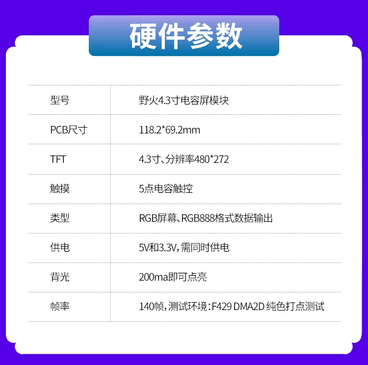

# 野火 F429 七电机小车：当前状态与已确认信息

更新日期：2026-10-22。代码核对基线：main，`170307e`（核心模块中文总览）；功能修复提交：`0a2354e`。

**本文是本工程当前状态、需求和交接的统一入口。原计划书、阶段任务书、交付书及前期方案均已过时，仅供历史参考；与本文冲突时以本文为准，不再直接执行其中的旧交接指令。** 历史测试仍可作为对应版本的证据，不能据此推定当前实物已全部验收。若后续源码与本文发生差异，应核查并更新本文，不用旧文档覆盖新代码。

本轮整体整理 README，合并重复增补、消除阶段间矛盾，只更新文档，不改变固件配置或运行代码。没有新建分支、重新烧录或重新进行硬件测试。

## 1. 当前结论与实物进度

| 项目 | 当前已知状态 | 证据与范围 |
|---|---|---|
| 工程平台 | 野火 STM32F429 挑战者 V1 核心板，不使用野火底板；7 台电机 | 用户确认；H743＋8 电机是独立方案，不属于本工程 |
| 扫码 | **已实测成功，运行正常，可稳定扫码** | 用户于 2026-10-22 确认；USART3 9600/8N1、手动电平触发、PB12 低有效、15 字符任务码及换行结束符均匹配 |
| 单电机 | **已实测成功，运行正常** | 用户于 2026-10-22 确认；未提供测试固件提交、完整动作清单及异常注入记录，不扩展为七机或所有故障策略通过 |
| 七电机 | 总线、控制、反馈、启动流程和故障处理已实现并有主机回归 | 尚未七机实测；地址用途确定，逐台实物配置尚未全部核对 |
| 光流 PMW3901 | 已集成软件；**已固定安装** | 用户确认；尚未实测采集，毫米换算未标定；高度、朝向及地面条件数值未记录 |
| 陀螺仪 | 已集成单轴角速度＋相对转角 | 尚未接线/固定或实测；I2C 地址、安装轴/符号保留软件默认并标待验 |
| LCD/触摸 | 4.3 寸 RGB 电容触摸屏；原画板曾运行且可触控 | 扫码、单电机实测正常；最新四页布局、时序、四角及比赛字高没有专项实测记录 |
| 上位机回传 | **确定采用 USART1 有线串口** | 用户确认链路；当前只有串口初始化/printf 重定向，业务协议、接收端和数据频率尚未确定/实现 |
| 舵机 | 仍为 2 个 270° PWM 舵机 | 用户确认；完整型号、机构用途未定，控制未实现 |
| 整车功能 | 外设联调基础已具备，尚未形成比赛自主运行程序 | 麦轮解算、定位融合、导航、机构回零/限位、比赛动作状态机尚未实现 |

**默认保留四轮上电测试。** 用户已于 2026-10-22 再次确认此需求。不能将本固件笼统描述为“上电只读”或“上电不运动”；测试正常完成后才恢复 READ ONLY。

## 2. 整车组成与地址

电机为 X42S_V2.0 光耦版，采用 Emm 固件、TTL 串口。代码按固定地址 1～7 创建节点，不自动修改电机地址或写入持久化参数；具体固件版本、应答设置及多机电气连接仍待逐台核对。

| 地址 | 角色 | 已确认用途 |
|---|---|---|
| 1 | 前左轮 | 麦克纳姆底盘，主要按速度控制 |
| 2 | 前右轮 | 同上 |
| 3 | 后左轮 | 同上 |
| 4 | 后右轮 | 同上 |
| 5 | 旋转臂 | 通过履带传动旋转机械臂 |
| 6 | 上下轴 | 升降 |
| 7 | 前后微调轴 | 伸缩，末端约 50 mm 微调 |

“50 mm”是用户描述的微调需求，尚不代表已标定总行程或正负行程。限位开关确定会增加，但数量、位置、常开/常闭、电路、引脚、零点方向、脉冲换算和机构行程均未定。底盘轮径、轮距、轴距、减速比、四轮正转方向也未测定；目前不能把电机 RPM 或脉冲直接换算成车体速度/位移。

## 3. 工程、工具链与资源

| 项目 | 当前配置 |
|---|---|
| 工程路径 / 目标 | `E:/工创赛/迁移野火板/Project/YH-F429.uvprojx`，Keil 目标 `LCD` |
| MCU | STM32F429IGT6 / 工程 STM32F429IGTx，Cortex-M4F，LQFP176 |
| 存储器 | 片内 Flash 1024 KiB、RAM 256 KiB（含 64 KiB CCM）；核心板另有 SDRAM、SPI Flash |
| 软件框架 | STM32 HAL 1.7.3；Arm Compiler 5.06 update 7 build 960（AC5） |
| 时钟 | HSE 25 MHz；PLLM=25、PLLN=360、PLLP=2、PLLQ=7；HCLK 180 MHz、APB1 45 MHz、APB2 90 MHz |
| 初始化方式 | 现有 main/BSP 的 C/HAL 初始化；本工程没有 .ioc，不需要从零重建 CubeMX |
| 显示 | LTDC＋DMA2D，480×272、ARGB8888；单层 522240 字节，外部 SDRAM 0xD0000000 |
| 触摸选择 | 源码选择 GT1151QM 4.3 寸配置；实物芯片型号没有单独确认记录 |
| 调度 | 协作式主循环，无 RTOS；main 中静态 QrApp，统一推进所有服务 |
| 栈 / DMA | 配置栈 4096 字节；UART DMA 缓冲在 DMA 可访问的片内 SRAM，不在 CCM 或 SDRAM |
| 产物 | `Output/YH-F429.hex`、`.axf`；Output、Listings 被 Git 忽略 |

PLLQ 当前不是精确 48 MHz，工程没有新增 USB 业务。旧 MotorDemo、单机 service/UI 和测试保留，默认 main 不调用 MotorDemo_Process；它与当前四轮启动流程是不同实现。

### 3.1 已配置引脚

下表“代码配置”不自动等同实际接线；扫码已由用户确认配置匹配，单电机已有正常运行记录，其它模块按第 1 节区分。

| 功能 | MCU / 接口 | 配置 |
|---|---|---|
| 电机 | UART5：PC12 TX、PD2 RX | 115200/8N1；RX DMA1 Stream0/Channel4，TX Stream7/Channel4 |
| 扫码 | USART3：PB10 TX、PB11 RX | 9600/8N1；RX DMA1 Stream1/Channel4 |
| 扫码 TRIG | PB12，V1 J7-14 | 推挽、低有效；周期 1000 ms，其中低电平 800 ms |
| 上位机/调试 | USART1：PA9 TX、PA10 RX | 115200/8N1；当前 printf 使用，业务回传待实现 |
| 光流 SCLK | SPI2 PB13，J7-54 | AF5；Mode 3，8 bit，MSB first；APB1/64=703125 Hz |
| 光流 MISO | SPI2 PC2，J7-16 | MCU 输入，接模块输出 |
| 光流 MOSI | SPI2 PC3，J7-52 | MCU 输出，接模块输入 |
| 光流 CS | PE3，J7-49 | 独立 GPIO，低有效 |
| 陀螺 SCL | I2C1 PB6，J7-32 | AF4、开漏，100 kHz |
| 陀螺 SDA | I2C1 PB7，J7-31 | AF4、开漏 |
| 触摸 | I2C2 PH4/PH5；PD11 RESET、PD13 INT | 沿用野火 BSP；EXTI 只通知，前台处理触摸 |
| Flash | SPI5 PF7/PF8/PF9、PF6 CS | 保留现有 BSP |
| 显示/显存 | LTDC、FMC/SDRAM、DMA2D | 保留原板资源；完整网络以 V1 原理图及 BSP 为准 |

HAL UART MSP 按 USART1/UART5/USART3 分支；统一回调位于 `User/usart/bsp_uart_callbacks.c`。UART5/USART3 各自 RX DMA 缓冲 256 字节、软件队列 512 槽，UART5 TX 持久缓冲 128 字节。光流不用 SPI DMA/EXTI；陀螺与触摸不共用 I2C 总线。

### 3.2 模块接线边界

- **电机 TTL：**主控 TX → 电机 R/A/H，主控 RX ← 电机 T/B/L，共地。光耦脉冲端和 TTL 通信端是不同接口。七台的实际参数、并联接法和电平尚未整体验证。
- **扫码：**用户已确认上述接口/模式/格式可稳定工作。裸 XM1605 资料的 12Pin 为 2=VCC、3/8=GND、4=RX、5=TX、12=TRIG；不能套用成任何转接板的排针顺序。当前固定波形用于手动电平触发；连续模式下 TRIG 的暂停/继续语义不同。实物电源/转接电路细节尚无完整记录。
- **光流：**方案使用 3.3 V 供电/逻辑，共地；模块 VCC 直接关联 VDDIO，不能因有稳压器就按 5 V 接入。资料的 MIS/MOS 丝印与信号方向有歧义：必须按芯片 MOSI 输入接 PC3、MISO 输出接 PC2，不能只看缩写。RESET 不接 MCU、依赖模块上拉及软件复位；MOTION、VREG 不接，VREG 不是外部供电口。用户确认已固定安装，不等于电气/采集验证完成。
- **陀螺：**型号 WDS601M-ICM-42688，资料目标芯片 ICM-42688-P，MODULE。用户确认引脚为 **VCC、GND、SCL、SDA、SA0、CS、INT1、INT2**。当前实现走芯片直连 I2C：VCC=3.3 V，CS 拉高，SA0 拉低选 0x68，INT1/INT2 不接 MCU。PS/模式焊点按模块资料保持开路，SCL/SDA 外部上拉到 3.3 V；实物模式、上拉、电平仍未核对。若 SA0 确认固定高，需明确改为 0x69，代码不自动猜地址。未使用板载 MCU 的串口/解算接口。

核心板供电与屏幕排线的历史事实：原画板曾由 DAP LINK 下载并正常显示/触控；屏幕产品资料为 4.3 寸、480×272、5 点触摸、RGB888，要求 5 V 与 3.3 V。原图仅作规格记录，标称刷新指标不是当前应用性能：



## 4. 当前程序架构与运行效果

`main → QrApp_Init / QrApp_Process` 统一编排以下模块，后台服务不因切页停止：

| 模块 | 当前职责 | 主要位置 |
|---|---|---|
| 应用 | 四轮启动状态机、触摸意图分发、校准门控、各服务调度 | `User/app/qr_app.c` |
| 电机 | Emm 构帧/解析、七节点独立状态、唯一 UART5 调度、控制/停止/反馈 | `User/motor/emm_protocol.*`、`motor_bus.*` |
| 扫码 | UART 字节接入、文本组帧、任务码解析、会话锁定/重扫 | `User/qr/`、`User/usart/bsp_qr_*.c` |
| 光流 | SPI2 适配、PMW3901 分步初始化、Burst、质量/累计/恢复 | `User/flow/` |
| 陀螺 | I2C1 适配、ICM42688 初始化、单轴速率、CAL/ZERO/积分/恢复 | `User/gyro/` |
| 界面 | QR/MOTOR/FLOW/GYRO 页面、快照文本、可取消的分步绘图 | `User/app/qr_ui.*` 及 flow/gyro UI |
| 底层 | 时钟、LCD/SDRAM/触摸、UART/DMA、SPI/I2C | `User/main.c`、各 BSP；HAL 保持原版本 |

当前传感器和扫码结果用于采集、诊断和显示，尚未用于自动导航或触发比赛动作。新增业务应通过现有 MotorBus API 发送，不另建 UART5 发送者。

### 4.1 上电与手动控制

1. 初始化屏幕/通信、扫码第 1 会话、光流及陀螺服务；默认显示 QR 页并后台查询 1～7。
2. 四轮启动流程等待 1～4 的新鲜、健康、零速反馈，再依次使能。
3. 按 1→2→3→4，以 10 RPM、约 1 秒节拍逐轮启动，再按同一顺序逐轮停止并验证。节拍受事务/反馈影响，不是实物精密定时保证。
4. 每次 MCU 上电/复位只执行一轮，正常完成回 READ ONLY。该启动流程不对 5～7 发控制命令；全体 STOP 或用户手动操作另按其范围执行。
5. STOP、超时或异常中止后不重放启动/运动；未确认停车继续按停止策略处理。缺轮不能视为启动成功。

电机页可进入 MANUAL，选节点/动作，RUN ONCE；底部全体 STOP、详情 STOP AXIS/STOP WHEELS 保留，退出手动会请求停车。按钮均为按下边沿触发，按住不重复，不是长按手势。

| 配置 | 默认值与实际含义 |
|---|---|
| MOTOR_BOOT_SEQUENCE_ENABLED | 1；用户确认保留四轮启动。显式构建为 0 可做只读/独立传感器台架 |
| MOTOR_TEST_CONFIGURED | 0；UI 位置、四轮组、同步测试模板尚未开放 |
| MOTOR_BENCH_JOG_ENABLED | 1；MANUAL 下仍允许单轴 10 RPM、1 s 点动，并受反馈条件约束 |
| MOTOR_TEST_PULSES_PER_REV | 0；机构脉冲换算未配置，不能将测试的 32 脉冲当作 50 mm |
| MOTOR_SYNC_CLEAN_BOOT_CONFIRMED | 0；同步缓存默认锁定，无已实测的运行期解锁方案 |
| MOTOR_DRIVER_REQUIRE_MANUAL | 0；驱动 API 不强制 UI 会话，程序化调用方负责明确动作意图；UI 仍要求 MANUAL |
| MOTOR_UNKNOWN_AUTO_RECOVER_MS | 500；只有无未确认停止意图、获得新的零速/无故障反馈并满足稳定窗，才允许 UNKNOWN 自愈 |

这些宏集中在 `User/motor/motor_test_config.h`。UI 测试模板的开关不等于所有公共 API 的能力开关；API 本身仍检查反馈、动作参数、目标/脉冲关系及同步锁。

### 4.2 电机通信与停止语义

已支持单轴使能、限时速度、三种位置脉冲模式（相对上一输入目标、相对坐标零点、相对当前实际位置）、四轮 37 字节 0xAA 速度聚合、传统缓存同步及逐轴反馈。不是七台实物已经同步验证。上一次输入目标不明时拒绝对应相对模式；同步缓存失败会锁定，MCU 复位不证明电机缓存已清。

总线只有一个活动请求；最小命令间隔 10 ms、应答期限 60 ms、取消/超时隔离 120 ms。正常位置/速度/状态轮询目标各约 500 ms，实际频率受控制、重试和离线节点影响；当前新鲜度阈值为 1600 ms。位置/速度/状态各有独立时间戳，界面过期显示 STALE/--，不能只凭曾接收过的 valid 位确认当前反馈。

**2026-10-22 已落地的故障修复：**

- UART5 在清 IDLE 前检查 PE/FE/NE/ORE，DMA 回调同样隔离；恢复丢弃受影响的 DMA、软件队列及协议半帧。检查本次 RX/TX DMA 启动状态，覆盖旧 HAL 返回 OK 但底层未启动的情况。恢复失败至少间隔 100 ms；RX 错误不主动截断在途 TX。
- RX 不可用时阻止所有 TX（包括 STOP），停止意图保留，接收恢复后继续；当前没有 TX-only 停止通道。
- STOP 的“待发送”“已提交”“未确认”“已确认”分开。首次提交及两次快速尝试至少间隔 200 ms，此后至少 1000 ms 一次，轮转轴并让出反馈事务；忙/隔离会延后实际发送。
- 重复 STOP 合并，不重置首次期限或证据基准。只有首次 STOP 提交后新取得、仍新鲜的零速和无保护/堵转状态，才确认停止。ACK、DMA 完成、旧零速均不够。
- 3 s 到期可转 UNKNOWN，但保持 STOP UNCONF、运动禁入及重试；界面概览 STOP?、详情 STOP UNCONF。收到足够停车证据后停止重发。位置/速度动作本身不自动重放。
- STOP 不自动 Disable，尤其地址 6 不用失能替代升降停车。实物保持力矩与机械制动效果尚未验收。

协议线上没有事务序号，超过隔离期的同地址同码迟到响应仍有归属限制。链路断开、MCU 停机或重启时，软件不能保证机械停住；重启也不保留 RAM 中的未决意图。现有单机正常实测不覆盖这些故障情形。

### 4.3 扫码

接受固定 15 字符 `ddd+ddd+ddd+ddd`，按 CR/LF/CRLF 组帧。两批颜色各取 1～6 且不重复、集合相同；每批位置为 1～3 的排列；不从噪声里截取合法片段。用户已确认实物设置匹配且可稳定扫码。

每会话只发布并锁定一个合法任务；重复/其它码不替换。RESCAN 清当前结果、本机旧缓冲并增加会话，保留累计统计/历史；重扫等待结束符或 250 ms 无数据间隙重新同步，边界处可能丢弃首条记录。10 秒 WAIT TIMEOUT 后仍接收，静默不判离线。UART/溢出/半帧超时丢弃受损记录，不覆盖已锁定结果。

PB12 周期触发在锁定后仍继续；只更新 DUP/IGN 等统计。扫码、RESCAN、切页及故障恢复均不触发电机动作。纯文本接口不能完全识别模组内部滞留后才输出的旧码。

### 4.4 光流

PMW3901 通过分步初始化、身份验证与 12 字节 Motion Burst 获取有符号 dx/dy，目标 100 Hz。显示/输出单位是 **counts**，有效样本独立累计到 64 位总量；没有 mm 换算或车体闭环。

当前 `FLOW_MIN_SQUAL=25` 是待实物验证的调试阈值；新鲜度 100 ms，身份周期检查 500 ms；低质量/错误不累计，不用旧值补算。默认不交换轴、X/Y 都为正号，尚未确定车体前后/左右映射。CLEAR 仅清软件累计，不清统计、扫码会话或传感器内部尚未读出的增量，因此不是精确物理时间边界。

SPI/身份错误或连续 2 s 无有效数据进入恢复，1→2→4→8 s 退避；重初始化保留累计但增加段号/间隙，丢失位移不补算。FLOW 显示计数、质量、年龄和错误，MORE 显示通信/跟踪/新鲜度、耗时与间隔。用户已固定安装，但采集、方向、高度适用性、毫米系数和地面精度尚未实测。

### 4.5 陀螺仪

仅输出选定旋转轴的 **角速度（deg/s）＋相对转角（deg）**。默认 Z+、地址 0x68、±500 °/s、100 Hz、65.5 LSB/(°/s)，这些是源码默认，非实物安装结论。使用条件为所选轴近似竖直、车体近似平面运动；相对积分会漂移，不是绝对航向或任意姿态欧拉 yaw。

驱动核验 WHO_AM_I=0x47；轮询 DRDY，只有新样本参与积分。未启用加速度业务、温度、FIFO、磁场参考或姿态融合；时间戳来自 MCU 毫秒时钟，漏样无法追回。

- 上电 UNCAL，不自动校准。确认启动流程结束且整车/模块静止后按 CAL，收集约 2 s、至少 201 连续样本，通过绝对值/均值/波动检查后更新 RAM 偏置并归零。偏置不存 Flash。
- CAL 使用当前时间的新鲜度：运动为 MOTOR ACTIVE，相关反馈不足为 MOTOR UNKNOWN，未确认停车为 STOP UNCONF。轴范围默认 0x7F；从未发现且从未命令的节点可缺省，任何轴未确认 STOP 都不能绕过。独立台架须显式关闭四轮启动；默认缺轮不能自动绕过。
- ZERO 在已校准且最新样本可用、未进行 CAL 时建立新角段，保留偏置。重新初始化后必须先 CAL；不能用 ZERO 代替校准。
- 轮询空档达到 10 ms、样本 dt 大于 14 ms/为零、过期 30 ms、非法码/饱和或总线故障会中断连续性，显示 REL -- / GAP。保留旧数值供快照诊断，但不当作有效角或跨空档积分。速率恢复后可 ZERO，或重新 CAL。
- 总线故障按 250 ms 至 4 s 退避；持续 500 ms 无有效样本会重初始化。电机零速与低方差不能证明没有外力推动或恒定慢转，CAL 仍要求操作者保证静止。

### 4.6 界面与主循环

四页共用可取消绘图状态机：一次至多绘制一个 480×4 矩形条带或两个字符后返回主循环。至少间隔 100 ms 请求新快照，当前作业每轮推进；冻结九行文本，切页取消旧作业。CAL/ZERO 不再触发整页重绘；标题最多 26 个 Font16 字符，QR/MOTOR 使用简短完整标题。

这是已实现的调度策略，不是实板耗时保证。单个 LCD/HAL 操作真正超预算时仍应显示 GAP，没有调宽陀螺 10/14/30 ms 阈值来掩盖丢样。诊断包括 UI 最大单步耗时及 gyro 最大轮询/样本间隔。

## 5. 已有软件验证与实物边界

本轮读取当前源码、提交和本地日志来整理文档，未重新执行固件测试/构建。最近功能修复为 `0a2354e`，之后 `170307e` 添加中文总览注释。

| 记录 | 已核对结果 |
|---|---|
| 全量主机测试 | `Output/fix_20261022/full-tests.log` 含默认/配置 QR UI、默认/严格七机、UART 故障、四轮启动、光流、三种 gyro 轴映射及两个 I2C 地址的通过记录 |
| 故障回归 | 包含 STOP 命令丢失/仅 ACK 丢失、持续离线与公平查询、UART 错误+IDLE/DMA 次序、DMA 假成功、CAL 门控、慢 LCD 和真实超预算 GAP |
| 最新本地构建日志 | `Output/build.log`：AC5，0 错误、0 警告；Code=59564、RO-data=17512、RW-data=1704、ZI-data=14392 字节 |
| 资源边界 | 修复构建 app 静态对象 5472 字节，配置栈 4096 字节；已知静态最大调用深度 1248 字节，存在函数指针/循环未知项，不是实测栈高水位 |
| 用户实测 | 扫码、单电机运行正常；其余按第 1 节，不把主机替身通过写成实物通过 |

慢 LCD 回归中的七节点＋扫码 10 Hz＋光流＋触摸＋gyro 场景记录：UI 单步最大 2 ms、gyro 最大轮询/样本间隔 3/14 ms、触摸 STOP 至 transport.send 11 ms、PB12 相位抖动 2 ms。**这些是指定替身成本模型的结果，不是实板性能、串口线上延时或机械停车时间。** 故意将单个绘图原语设成 12 ms 时，仍检出 GAP。

常用命令（在本工程目录执行）：

```powershell
.\Scripts\test.ps1
.\Scripts\build.ps1 -Rebuild
```

测试使用 MSVC /W4 /WX，构建脚本要求 Keil 0 警告。Output/Listings 的日志、HEX、map、预览图可被清理，重要验收记录需另行保存；HEX 存在不代表已经烧录。

实物仍待记录：七机共同通信/四轮启动、停止重试与反馈确认、UART 故障恢复、轴 6 保持；光流采集/标定；陀螺模式/接线/轴向/漂移；四模块联合运行的真实最慢绘图/采样/触摸时序；比赛显示字高和整车任务表现。

## 6. 未确定、未实现的事项

以下是明确缺口，不是已获确认的参数，也不是自动执行的开发任务书。

| 事项 | 当前边界 |
|---|---|
| 七台配置 | 地址用途已确定；实物固件/应答模式/菜单参数尚未全部核对 |
| 底盘模型 | 轮径、轮距、轴距、减速比、四轮方向未测；麦轮解算和车体速度接口未实现 |
| 三机构轴 | 限位、原点、方向、脉冲/mm或角度、行程未定；回零与限位处理未实现 |
| 舵机 | 数量与 270° 已确认；型号、机械用途、电源、PWM 引脚和行程未定 |
| 光流 | 已固定安装；安装高度/朝向未记录，实际采集和毫米标定未完成 |
| 陀螺 | 尚未接线/固定；保留 I2C1、0x68、Z+ 默认；精度/漂移未实测 |
| 上位机 | USART1 有线链路已确定；协议、消息字段、频率、PC 接收程序及与 printf 的共存方式未定 |
| 整车算法 | 光流/陀螺融合、里程计、定位/导航、机械臂动作和比赛任务状态机未实现 |
| 实物追溯 | 扫码/单电机测试通过，但对应固件版本和完整用例未记录；其余不能沿用这一结论 |

## 7. 文档与资料索引

### 当前代码入口

- [主程序](User/main.c)、[应用编排](User/app/qr_app.c)、[界面](User/app/qr_ui.c)
- [电机配置](User/motor/motor_test_config.h)、[电机 API](User/motor/motor_bus.h)
- [扫码配置](User/qr/qr_config.h)、[光流配置](User/flow/flow_config.h)、[陀螺配置](User/gyro/gyro_config.h)
- [光流第三方许可](User/flow/THIRD_PARTY_NOTICES.md)、[陀螺来源与许可](User/gyro/UPSTREAM.md)：仍有效，不属于过时计划/交付文档。

### 已过时，仅供参考的历史文档

下列正文保留当时的目标、接线依据、实施过程和证据，**不是当前项目事实的另一套来源**。其中“尚未实施”“未实测”“未提交”“单独分支”“上电只读”等描述可能只在当时成立；当前结论以本文为准。历史文档内的嵌套交接提示不再直接执行。

| 历史内容 | 文件 |
|---|---|
| 扫码阶段任务 / 交付 | [QR_UART_STAGE_TASK](Doc/QR_UART_STAGE_TASK.md)、[QR_UART](Doc/QR_UART.md) |
| 七电机阶段任务 / 交付 | [MULTI_MOTOR_STAGE_TASK](Doc/MULTI_MOTOR_STAGE_TASK.md)、[MULTI_MOTOR](Doc/MULTI_MOTOR.md) |
| 光流任务 / 开发基线 / 交付 | [OPTICAL_FLOW_STAGE_TASK](Doc/OPTICAL_FLOW_STAGE_TASK.md)、[OPTICAL_FLOW_BASELINE](Doc/OPTICAL_FLOW_BASELINE.md)、[OPTICAL_FLOW](Doc/OPTICAL_FLOW.md) |
| 陀螺任务 / 交付 | [GYRO_STAGE_TASK](Doc/GYRO_STAGE_TASK.md)、[GYRO](Doc/GYRO.md) |
| 审查修改计划 / 修复交付 | [审查计划](Doc/GYRO_MOTOR_REVIEW_FIX_PLAN_2026-10-22.md)、[修复报告](Doc/GYRO_MOTOR_FIX_REPORT_2026-10-22.md) |
| 单机历史演示 | [MOTOR_DEMO](Doc/MOTOR_DEMO.md) |
| 早期整车架构 / 起步 / 兼容性分析 | [整车架构](../迁移分析/七电机整车程序架构设计_2026-10-20.md)、[起步建议](../迁移分析/野火V1多外设项目_起步工程建议.md)、[迁移分析](../迁移分析/F429野火V1迁移兼容性分析.md) |

### 原始资料位置

| 资料 | 位置 |
|---|---|
| 赛题、评分与解析 | `E:/工创赛/官方文件`（命题.pdf、评分细则.pdf、赛题解析.pdf） |
| 电机官方资料/例程 | `D:/BaiduNetdiskDownload/ZDT_XS系列第二代闭环步进电机资料` |
| PMW3901 | `E:/工创赛/硬件说明/PMW3901光流传感器模块` |
| ICM-42688-P | `E:/工创赛/硬件说明/ICM-42688-P加速度六轴IMU陀螺仪` |
| XM1605 | `E:/工创赛/硬件说明/二维码扫描模组/XM1605扫码模组资料` |
| 舵机 | `E:/工创赛/硬件说明/PWM舵机（PM系列）` |
| 野火 V1 板资料 | `E:/MPU's_study/野火【STM32F429开发板-挑战者】资料` |
| 无极 S2 参考资料 | `E:/MPU's_study/无极S2开发板资料汇总` |

硬件说明目录中的 H743 八电机拓展板 README/设计文档属于用户确认的独立方案，本轮未改写，也不据此改变本工程主控或电机数量。

## 8. 后续维护规则

只有用户明确确认、当前源码落地或实际验证完成的信息才能更新为事实。实物结果注明模块、固件版本（若已知）、验证范围和日期；未知数据保持未定，不把资料默认值、软件初值或模拟测试值写成实测值。

后续在 main 上最小限度改动，保留既有模块和四轮上电需求；新功能交付时同步维护本文的当前行为、配置和验证边界。历史计划和交付文档保持过时标记，仅用于追溯。
